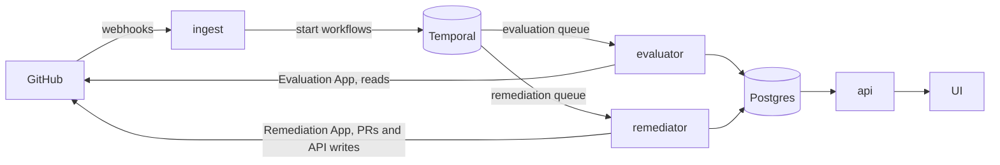

# repo-guardian

repo-guardian evaluates every repository in your GitHub organisations
against a compliance policy you keep as code, records who is compliant
with which control and why not, and, where the policy says so, opens a
pull request or makes the API change that fixes it.

> [!IMPORTANT]
> **v2.0.0 is a fresh install.** It does not read a 1.x `guardian.hcl`,
> the chart's 2.x major refuses every 1.x value, and the image's
> `latest` tag now points at 2.x. Anyone running `repo-guardian:latest`
> from the 1.x line should pin `1.14.1` first; the 1.x README is at
> [`v1.14.1`](https://github.com/donaldgifford/repo-guardian/tree/v1.14.1).
> Moving from 1.x is covered in
> [Migrating from v1 to v2](docs/operations/v2-migration.md); what 2.0
> is, in one page: the [2.0.0 release notes](docs/releases/2.0.0.md).

## How it works

- **The policy is a directory.** `enterprise.hcl` names the
  organisations and the controls every repository gets, `catalogue/`
  defines the controls, `orgs/` adds per-org controls, exclusions and
  overrides, and `templates/` overrides the embedded file templates.
  See the [policy reference](docs/usage/policy-reference.md).
- **The unit is a control.** A control (`codeowners@1`) has a type, a
  version and a set of rules. The built-in types cover files
  (`file`, `codeowners`, `catalog_info`, `dependency_updates`) and the
  GitHub API (`repo_settings`, `branch_ruleset`, `labels`,
  `custom_properties`); every one is listed in the generated
  [control-type reference](docs/usage/controls-reference.md).
- **Evaluate, then remediate.** Every assignment is evaluated. Only an
  assignment in `mode = "remediate"`, on a repository the Remediation
  App can reach, writes anything: one pull request per control on a
  `repo-guardian/<control>` branch, or a direct API change. It never
  force-pushes and never deletes a branch.
- **Two GitHub Apps.** The Evaluation App reads and is held by the
  evaluator. The Remediation App writes and is held by the remediator,
  and you install it only where you want fixes.
- **Temporal and Postgres.** Every repository has its own durable
  evaluation workflow on Temporal (which you run), with a rate budget
  per installation per App. Results, history and compliance live in
  Postgres, written by per-role database users that can each touch only
  their own columns.
- **A UI and a read-only API.** The business UI answers "who is
  compliant, since when, and what is being fixed" without PromQL; the
  OpenAPI 3.1 API serves the same data behind your identity provider.



The roles (`ingest`, `evaluator`, `remediator`, `api`, plus the UI) run
as separate Deployments in the chart's `split` topology, or together as
`all`. Ingest holds no App key and no database credential; the API
holds read-only database access only. The full picture is in
[repo-guardian and v2 at a glance](docs/operations/v2-overview.md).

## Install

The Helm chart is the only supported deployment:

```bash
helm install repo-guardian \
  oci://ghcr.io/donaldgifford/charts/repo-guardian \
  --version 2.0.0 \
  --namespace repo-guardian --create-namespace \
  -f values.yaml
```

Before installing you need a Temporal cluster, the two GitHub Apps and
a policy root. Start with [Getting started](docs/usage/getting-started.md)
for the walk-through, then
[Turning on repo-guardian v2](docs/operations/v2-onboarding.md) for the
production checklist. The chart's values are documented in the
[chart README](charts/repo-guardian/README.md);
[`examples/`](examples/) has policy roots and values files that the test
suite keeps in step.

Every image and chart is signed with cosign (keyless) and ships SLSA
Level 3 provenance and an SPDX SBOM. How to check them is in
[Verifying releases](docs/operations/verifying-releases.md).

## Documentation

- [Getting started](docs/usage/getting-started.md),
  [policy reference](docs/usage/policy-reference.md),
  [control-type reference](docs/usage/controls-reference.md)
- [The business UI](docs/usage/ui.md), [the read-only API](docs/usage/api.md),
  [identity providers](docs/operations/identity-provider.md)
- Operations: [scaling](docs/operations/scaling.md),
  [AWS](docs/operations/aws.md), [ingress](docs/operations/ingress.md),
  [schema migrations](docs/operations/migrations.md),
  [dashboards and alerts](docs/operations/monitoring-generation.md)
- [Adding a control type](docs/ADDING_RULES.md)

Design history is managed with [docz](https://github.com/donaldgifford/docz):

| Type | Directory | Description |
|------|-----------|-------------|
| RFC | [`docs/rfc/`](docs/rfc/) | High-level proposals |
| Design | [`docs/design/`](docs/design/) | Technical design documents |
| Implementation | [`docs/impl/`](docs/impl/) | Phased implementation plans |
| Investigation | [`docs/investigation/`](docs/investigation/) | Research and spike findings |
| ADR | [`docs/adr/`](docs/adr/) | Architecture decision records |

## Development

Tools are pinned in `mise.toml`:

```bash
mise install
make ci          # lint + test + build
make run-local   # Postgres + Temporal dev server via docker-compose.dev.yaml, migrate, run every role
make test-ui     # the UI's unit tests (Bun)
```

`make help` lists every target. [CONTRIBUTING.md](CONTRIBUTING.md)
covers branches, labels and releases.

## Operator CLI: rgctl

[`tools/rgctl`](tools/rgctl/README.md) is a separate command-line tool
for the move off 1.x. It reads a 1.x `guardian.hcl` without starting
the app, finds the pull requests repo-guardian 1.x opened, and closes
them with a pointer comment, dry run unless `--yes`. It is its own Go
module and never depends on the app's packages.

```bash
go install github.com/donaldgifford/repo-guardian/tools/rgctl@main
```

See [docs/operations/rgctl.md](docs/operations/rgctl.md).

## Security

Report vulnerabilities as described in [SECURITY.md](SECURITY.md).

## License

See [LICENSE](LICENSE) for details.
