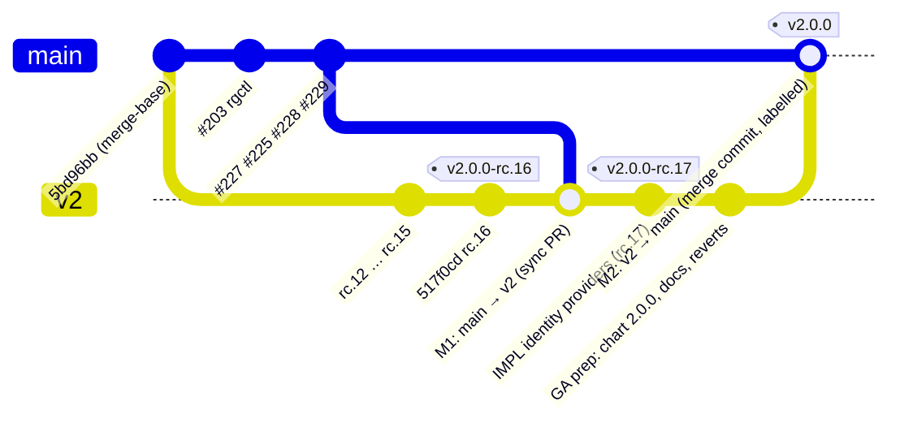
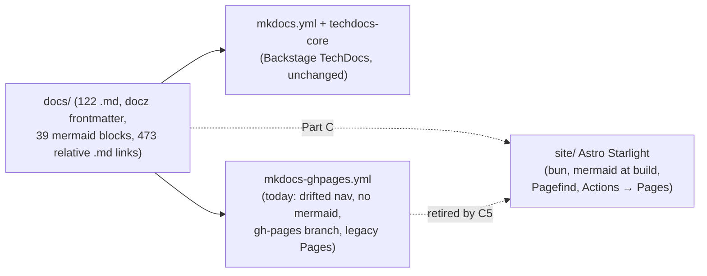
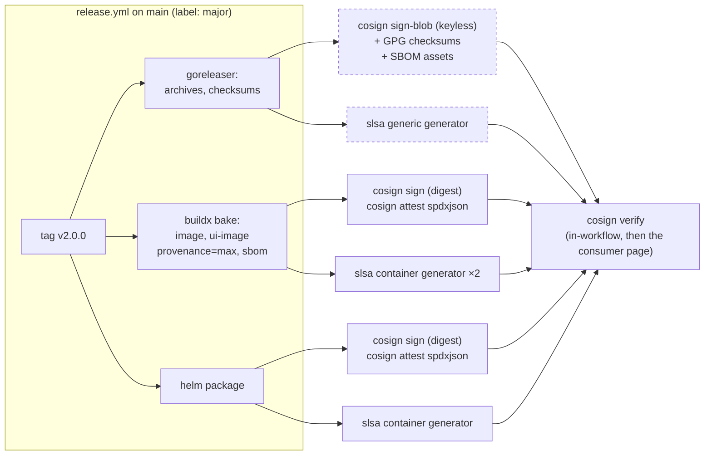

<!-- markdownlint-disable-file MD025 MD041 -->

# DESIGN-0038: v2.0.0 GA cutover and identity-provider portability

<!--toc:start-->
<!-- markdownlint-capture -->
<!-- markdownlint-disable MD013 -->
- [Overview](#overview)
- [Goals and Non-Goals](#goals-and-non-goals)
  - [Goals](#goals)
  - [Non-Goals](#non-goals)
- [Background](#background)
  - [Where the two branches stand](#where-the-two-branches-stand)
  - [What IMPL-0030 already decided](#what-impl-0030-already-decided)
  - [What the readiness audit found](#what-the-readiness-audit-found)
  - [How the API and UI authenticate today](#how-the-api-and-ui-authenticate-today)
- [Detailed Design](#detailed-design)
  - [Part A: the GA cutover](#part-a-the-ga-cutover)
    - [A1 Branch convergence](#a1-branch-convergence)
    - [A2 The release mechanism](#a2-the-release-mechanism)
    - [A3 The public docs site](#a3-the-public-docs-site)
    - [A4 The documentation rewrite](#a4-the-documentation-rewrite)
    - [A5 Changelogs](#a5-changelogs)
    - [A6 The v2 branch entries](#a6-the-v2-branch-entries)
    - [A7 The soak gate and the homelab tasks](#a7-the-soak-gate-and-the-homelab-tasks)
    - [A8 Bookkeeping at GA](#a8-bookkeeping-at-ga)
    - [A9 Consequences of latest moving](#a9-consequences-of-latest-moving)
  - [Part B: identity-provider portability](#part-b-identity-provider-portability)
    - [B1 The identity-provider contract](#b1-the-identity-provider-contract)
    - [B2 The token flow](#b2-the-token-flow)
    - [B3 Code changes](#b3-code-changes)
    - [B4 Chart changes](#b4-chart-changes)
    - [B5 Provider recipes](#b5-provider-recipes)
    - [B6 Verifying a provider](#b6-verifying-a-provider)
  - [Part C: the public docs site](#part-c-the-public-docs-site)
    - [C1 Two consumers, one source](#c1-two-consumers-one-source)
    - [C2 What the move has to carry](#c2-what-the-move-has-to-carry)
    - [C3 Generator comparison](#c3-generator-comparison)
    - [C4 The Astro Starlight shape](#c4-the-astro-starlight-shape)
    - [C5 Relationship to the GA cutover](#c5-relationship-to-the-ga-cutover)
  - [Part D: supply-chain and repository security](#part-d-supply-chain-and-repository-security)
    - [D1 What exists](#d1-what-exists)
    - [D2 The gaps](#d2-the-gaps)
    - [D3 The artefact trust chain after the changes](#d3-the-artefact-trust-chain-after-the-changes)
    - [D4 Tiers](#d4-tiers)
  - [Decisions](#decisions)
- [API / Interface Changes](#api--interface-changes)
- [Data Model](#data-model)
- [Testing Strategy](#testing-strategy)
- [Migration / Rollout Plan](#migration--rollout-plan)
- [Open Questions](#open-questions)
- [References](#references)
<!-- markdownlint-restore -->
<!--toc:end-->

<!--docz:overview:start-->
## Overview

The v2 line has shipped sixteen release candidates from the `v2` branch
and is running the controls model, remediation and the controls UI in
the homelab. This design settles what has to happen for `v2` to become
`main` and ship `v2.0.0`: how the two branches converge, how the GA
tag is produced so that a binary release, two registries and the chart
all come out of one push, what the public docs site and the landing
pages must say, and which of the IMPL-0030 soak gates still apply. It
also closes the one operator-facing gap the audit found on the way:
the API and UI are documented for Keycloak only, and three small
assumptions in the code and the chart would trip an operator on Okta,
Entra ID or Auth0. Part B makes the identity-provider contract
explicit, adds the knobs those providers need, and ships recipes for
each. Two further parts were added at review: Part C moves the public
docs site off the drifted MkDocs copy onto a generator that renders what
the docs actually contain (39 mermaid diagrams render as code today),
and Part D evaluates the repository's supply-chain security (scanners,
signing, SBOMs, provenance, pinning, branch rules) and tiers the gaps
into what GA needs and what follows.

The design is planning only. It produces four IMPLs: Part B (small,
additive, shipped as an rc before GA), the GA cutover (Part A with
Part D's first tier as a phase), the docs site (Part C, after GA), and
supply-chain hardening (Part D's remaining tiers, after GA). See OQ1,
OQ14 and OQ19.

<!--docz:overview:end-->

## Goals and Non-Goals

<!--docz:goals:start-->
### Goals

- `v2` becomes `main` through pull requests the `main` ruleset allows,
  with every rc tag still reachable and no history rewritten.
- One `v2.0.0` release: a signed goreleaser release, images on GHCR and
  ECR with SLSA provenance, the UI image, and the chart, all from one
  push to `main`, with jobs that visibly run (the June 2026
  `startup_failure` post-mortem).
- The public docs site publishes the v2 pages the moment `main` is v2;
  no page a new user reaches describes the v1 engine as current.
- The soak gates IMPL-0030 set for GA are honoured, not re-derived.
- An operator can run the API and UI against Okta, Entra ID or Auth0
  from the docs alone, and the code and chart no longer assume Keycloak
  where they do today.
- Every mechanical "v2 branch entry" (CI triggers, chart-testing
  target, CLAUDE.md rule 6) is listed with what changes at GA.
- The public docs site is built from the same `docs/` tree as TechDocs,
  renders mermaid, and is deployed from an Actions artefact rather than
  a long-lived `gh-pages` branch.
- Every release artefact (binaries, two images, chart) carries a
  signature, provenance and an SBOM a consumer can verify from one
  documented page; the repository's scanners cover Go, TypeScript,
  containers, the chart and the workflows; and a red check blocks a
  merge.

<!--docz:goals:end-->

<!--docz:non-goals:start-->
### Non-Goals

- An in-place upgrade from 1.x or from the pre-controls rcs. DESIGN-0032
  D27 made 2.0 a fresh install; `docs/operations/v2-migration.md` is the
  runbook and this design only fixes its contradictions.
- Supporting providers whose access tokens are not JWTs (Google) other
  than through a broker, or ID-token authentication at the API.
- Nested group-claim paths (`realm_access.roles`); see OQ9.
- IMPL-0026 (Temporal credential reload, OpenBao certificates) and
  DESIGN-0034 (CODEOWNERS ownership) stay post-GA, as IMPL-0030 recorded.
- A Go module path change to `/v2`; see OQ11.
- Changing the authorization model (groups → orgs, `defaultOrgs`,
  `clients`). It is provider-neutral already; only the claim it reads
  the client from is made configurable.

<!--docz:non-goals:end-->

<!--docz:background:start-->
## Background

### Where the two branches stand

As of 2026-10-24, `v2` is at 517f0cd (chart and appVersion
`2.0.0-rc.16`, PR #239) and `main` is at 1a825c0 (v1.14.1). The
merge-base is 5bd96bb. `main` carries five commits `v2` does not:

| Commit | PR | What it is | Needed on `v2` because |
| --- | --- | --- | --- |
| 1cbac0c | #203 | `tools/rgctl`, DESIGN-0035, IMPL-0027 | `v2-migration.md` steps 3 and 6 run `rgctl prs list` / `prs close`; the tool is untracked on `v2` |
| 0c89424 | #227 | Go 1.26.9, `x/text` v0.42.0 | superseded by #229 and `v2`'s own bumps; merges clean |
| b3c7785 | #225 | `docs/operations/rgctl.md` | the runbook links it |
| 93c21ba | #228 | `release.yml` `base-branch: true` | without it the bump reads every tag in the repository; that is how #227's `patch` label cut a `v2.0.0` from v1 code |
| 1a825c0 | #229 | Go 1.26.10 | `v2` already has it (c65d66c); merges clean |

The `main` ruleset requires a pull request and forbids deletion and
non-fast-forward pushes, with no bypass actors. `git push origin
v2:main` is refused, so IMPL-0030 OQ12's "fast-forward `main` to `v2`"
cannot be done literally; it has to be a pull request, and the merge
method matters (A1).

The bogus `v2.0.0` from #227 has been deleted: the remote has
`v2.0.0-rc.1` through `rc.16` only and `gh release view v2.0.0` is
"release not found".

### What IMPL-0030 already decided

IMPL-0030 owns the cutover's operational half. Its decisions stand and
this design builds on them rather than reopening them:

- **Phase 9 (9.1–9.10)**: tag the remediation rc, create the Apps,
  stop the old writers, delete the old schedules, record the old PRs
  with rgctl, install fresh, verify evaluation and KEDA, remediate one
  org, then the rest, keep the old databases. All human-run, none
  ticked.
- **OQ7**: `donaldgifford` in `remediate` for 7 days with every hold
  explained, then the remaining orgs, then GA after 7 more days with no
  unexplained `conflict`, `foreign_branch` or `permission` hold.
- **OQ8**: old databases kept until 2.0.0 has run 14 days.
- **OQ12**: tag `v2.0.0` on `main` after converging, `dont-release` on
  the merge PR, tag pushed by hand. A2 shows that the hand-pushed tag
  publishes only the chart and proposes a revision (OQ2).
- **Phase 10**: chart `2.0.0`, changelogs regenerated, in-place homelab
  upgrade from the rc, docz statuses, memory.

### What the readiness audit found

A read-only audit of the tree on 2026-10-24 found four things that
would break or mislead if `v2` were flipped today, plus a set of
smaller items. In order of blast radius:

1. **No workflow produces the v2.0.0 binary release as planned.**
   `release.yml` runs goreleaser only off the semver bump; with
   `dont-release` the bump is skipped, the release job is skipped,
   and `publish-ghcr`/`publish-ecr` run with an empty `tag`, so their
   image jobs are gated off. `prerelease.yml` matches `v*-*` only. The
   only workflow a hand-pushed `v2.0.0` tag triggers is
   `changelog-update.yml`.
2. **The public docs site would publish v1.** `gh-pages.yml` deploys
   `mkdocs-ghpages.yml` on every push to `main`. That file's nav has
   Getting Started and Policy Reference under Usage, DESIGN/IMPL entries
   up to 0009 and no Operations section; none of `controls-reference`,
   `ui`, `api`, `v2-*` is in it. `mkdocs.yml` (the TechDocs config)
   has them all.
3. **The landing pages describe v1.** `README.md`, `docs/index.md`,
   `docs/usage/getting-started.md`, `docs/ADDING_RULES.md`,
   `docs/operations/{aws,scaling,ent-setup}.md` and the chart README's
   introduction still describe reconcilers, `guardian.hcl`, Valkey,
   `watch = true` and chart values the 2.x chart fails the render on.
4. **`v2-migration.md` contradicts itself** on `RECONCILE_FRESHNESS`
   (read by `migrate` at line 225; "none" at 271) and `migrate.freshness`
   (a replacement at 236; removed at 295).

Smaller: `changelog-update.yml` does a full `git-cliff` regeneration on
the tag push, which IMPL-0029 9.5 noted would drop the hand-written
1.x entries; the UI changelog gate needs a `2.0.0` entry beside the
chart bump; IMPL-0028 is Draft with every task ticked, IMPL-0025's body
says Draft while its frontmatter says Completed, DESIGN-0036 is
Approved; #232 and #235 are fixed in code but open; the
`deploy/MIGRATED.md` tombstone is due 2026-11-30; two Dependabot alerts
on `main` are already fixed on `v2`.

### How the API and UI authenticate today

DESIGN-0027 specified a provider-neutral contract: the API takes an
OIDC **access token** for its audience, reads a name claim and a groups
claim, and maps groups to orgs in a YAML file. The implementation is
faithful to that:

- `internal/api/authn.go`: go-oidc discovery, RS256/ES256 only, `iss`
  equal to `OIDC_ISSUER`, `aud` containing `OIDC_AUDIENCE` (string or
  array), 60s skew on `exp`/`nbf`, refuses tokens carrying `nonce`,
  `at_hash` or `typ: ID`, then reads `OIDC_NAME_CLAIM` (default
  `preferred_username`) and `OIDC_GROUPS_CLAIM` (default `groups`) as
  top-level keys. `Claims.Client` is read from **`azp`** and nothing
  else.
- `internal/api/authz.go`: `groups` → orgs, `defaultOrgs`, and
  `clients` keyed on that `azp` for IdPs that put no groups on
  client-credentials tokens (DESIGN-0027 OQ22).
- `ui/server/`: authorization code + PKCE S256 with `state` and
  `nonce`, scopes from `OIDC_SCOPES` (code default `openid profile
  email offline_access`), token endpoint authentication hard-coded to
  `client_secret_post`, no `audience`/`resource` parameter, access
  token forwarded to the API, refresh within 60s of expiry, RP-initiated
  logout when discovery advertises `end_session_endpoint`, revocation
  when it advertises `revocation_endpoint`.
- Chart: `api.auth.{issuer,audience,nameClaim,groupsClaim}`,
  `api.authz.*`, `ui.oidc.{clientId,scopes}` with the scopes default
  `[openid, profile, groups, offline_access]` (which differs from the
  code default), `ui.existingSecret`. The UI's issuer is
  `api.auth.issuer`. `values.schema.json` declares `api.auth.enabled`,
  `issuer`, `audience` only.
- Docs: the authentication rules in `docs/usage/api.md` are neutral; the
  only setup walkthrough is "Keycloak example", and `docs/usage/ui.md`
  points at it. Okta and Entra appear only in DESIGN-0027's diagram and
  in the Temporal client-credentials discussion (DESIGN-0028, INV-0020).

So the code is close to neutral. What would stop an Okta operator is a
`clients` block that silently does nothing (Okta issues `cid`, not
`azp`), an app that has to be switched to `client_secret_post`, a chart
scope default (`groups`) that Okta's custom authorization servers
reject as undefined, and no page telling them any of that. Auth0 adds
one more: without an `audience` parameter it returns an opaque access
token, which the API refuses as malformed. Google's access tokens are
always opaque, so Google only works behind a broker.

<!--docz:background:end-->

<!--docz:detailed-design:start-->
## Detailed Design

### Part A: the GA cutover

#### A1 Branch convergence

Two merges, both merge commits, both through pull requests:



**M1, `main` into `v2`.** A sync PR against `v2` that brings rgctl, the
rgctl runbook and the `base-branch: true` guard. Conflicts are expected
only in `release.yml` (keep the guard) and `go.mod`/`go.sum` (keep
`v2`'s newer versions). After M1, `v2` is a superset of `main` and the
final merge is conflict-free by construction.

**M2, `v2` into `main`.** A PR against `main`, merged with the **merge
commit** method. Squash would collapse the whole v2 history into one
commit and leave every rc tag pointing at commits no longer reachable
from `main`; rebase would rewrite them. A merge commit keeps the rc
tags reachable, which A2 depends on, and keeps `git log main` honest
about what shipped in each rc. The repository's default merge method
for feature PRs is squash; M2 is the one PR where the maintainer picks
"Create a merge commit" by hand (D1).

Everything that must be true of `main` at GA (chart `2.0.0`, the docs
rewrite, the branch-entry reverts, the `2.0.0` changelog entry) lands
on `v2` **before** M2, in the GA-prep PR, so that M2 carries a tree that
is already GA-shaped and the push to `main` can be the release.

#### A2 The release mechanism

The pipeline on `main` is `release.yml`: `bump-version`
(`jefflinse/pr-semver-bump`, mode `bump`) reads the merged PR's labels,
tags, and hands the tag to `release` (goreleaser) and to `ghcr.yml` /
`ecr.yml` (image, UI image, chart, three SLSA jobs each). The action
chooses the version to bump from by parsing every tag as semver (loose,
so pre-releases parse), sorting descending, and with `base-branch:
true` taking the newest one whose commit is reachable from the base
branch; annotated tags are dereferenced.

After M2, the newest tag reachable from `main` is `v2.0.0-rc.16` (or
`rc.17`, see A1), because the rc tags point at `v2` commits that the
merge commit makes reachable. node-semver's increment rules for a
pre-release of `2.0.0` are:

| Label on the merge PR | `semver.inc("2.0.0-rc.N", …)` |
| --- | --- |
| `major` | `2.0.0` |
| `minor` | `2.0.0` |
| `patch` | `2.0.0` |

So **a labelled M2 produces exactly `v2.0.0`**, and the whole pipeline
designed for 1.x releases runs: goreleaser builds and signs the
binaries and creates the GitHub release; `ghcr.yml` and `ecr.yml`
receive `tag: v2.0.0`, build and push both images with `latest` and
`2.0` tags (`!contains(tag, '-')`), publish the chart, and attach SLSA
provenance to all three. Nothing is pushed by hand.

This revises IMPL-0030 OQ12(a) (`dont-release` + hand tag), which would
have left `release` skipped and both image jobs gated off; the hand tag
would have triggered only `changelog-update.yml`. The label is
**`major`** (OQ2), because that is what the release is, and because
`major` is the only label whose semantics survive if the rc tags were
ever unreachable (a `minor` or `patch` from `1.14.1` would cut `1.15.0`
or `1.14.2`, silently, from v2 code). The pre-merge checklist therefore
includes: `git tag --merged <M2 head>` shows `v2.0.0-rc.16`; no
`v2.0.0` tag or release exists; `release.yml` on the merge head has
`base-branch: true`; the PR carries exactly one semver label.

```mermaid
sequenceDiagram
  participant PR as M2 merge (label: major)
  participant R as release.yml
  participant B as bump-version
  participant G as goreleaser
  participant P as ghcr.yml / ecr.yml
  PR->>R: push to main
  R->>B: pr-semver-bump (base-branch: true)
  B-->>B: newest reachable tag = v2.0.0-rc.N
  B-->>R: tag v2.0.0
  R->>G: release --clean @ v2.0.0 (GPG-signed)
  R->>P: tag=v2.0.0
  P-->>P: image, ui-image, chart + SLSA ×3; latest & 2.0 tags
  P-->>R: digests
```

Two guards from the release post-mortem carry over unchanged: confirm
the push-triggered run **creates jobs** (a `startup_failure` has none
and is only visible on the run's web page), and read digests from the
expression layer, never from a shell-inlined metadata blob.

`prerelease.yml` keeps working for future `vX.Y.Z-rc.N` tags on `main`:
the `v*-*` filter does not match `v2.0.0` and the file is harmless on
`main`. Its comment ("lives on v2 until v2.0.0") is updated (A6).

#### A3 The public docs site

`mkdocs.yml` and `mkdocs-ghpages.yml` differ only in that the TechDocs
config has `exclude_docs` and `plugins`, and the GitHub Pages config has
`theme: material`; their navs have drifted because docz updates only
`mkdocs.yml`. The fix is one source of truth: `mkdocs-ghpages.yml`
becomes

```yaml
INHERIT: mkdocs.yml
theme:
  name: material
```

so the nav docz maintains is the nav the public site deploys, and the
Pages-specific theme stays where it is (D2). `make lint-docs` (or the
existing docs job) gains `mkdocs build --strict --config-file
mkdocs-ghpages.yml` so a broken inherit or a nav entry pointing at a
deleted page fails CI instead of the deploy. OQ3 offers deleting the
second file instead.

The nav itself is reorganised in the same PR: Usage leads with the v2
pages (Getting Started rewritten, Policy reference, Control-type
reference, UI, API, the identity-provider page from Part B),
Operations gets a section (v2 overview, onboarding, migration, rgctl,
ingress, monitoring generation, scaling, ECR publish, AWS), and the
pre-v2 pages that remain useful as history are grouped under a
"Historical (1.x)" heading rather than deleted (A4).

#### A4 The documentation rewrite

The rule for every page is: a new reader must not be able to reach a
page that presents the v1 engine as the current product without the
page saying so in its first paragraph. Three dispositions:

| Page | Disposition | Notes |
| --- | --- | --- |
| `README.md` | **Rewrite** | Two Apps, controls and policy root, evaluate/remediate, Temporal + Postgres, UI/API; chart install at `2.0.0`; architecture diagram from `docs/operations/v2-overview.md` |
| `docs/index.md` | **Rewrite** | Mirror the README's opening; link v2 overview, onboarding, UI, API |
| `docs/usage/getting-started.md` | **Rewrite** | Fresh install walk: Apps, policy root, chart values, first evaluation, turning on remediation per org |
| `docs/ADDING_RULES.md` | **Replace** | Becomes "Adding a control type": `controls/builtin`, `Semantics()`, `TestRevisionGolden`, `repo-guardian controls docs`; the old content moves under Historical |
| `docs/operations/aws.md` | **Rewrite sections** | Drop ElastiCache/Valkey; RDS for the controls database with `rg_evaluator`/`rg_remediator`; Temporal is the operator's |
| `docs/operations/scaling.md` | **Rewrite sections** | Drop `staleSweep.*`/`queue.valkey.*`; KEDA per queue, `evaluator.*`/`remediator.*`, pool sizing; keep the posture/`max by` section |
| `docs/operations/ent-setup.md` | **Rewrite sections** | Two Apps with policy-derived permissions (`registerRemediation` logs them); webhook URLs per App |
| `charts/repo-guardian/README.md.gotmpl` | **Rewrite intro** | Never the rendered README (IMPL-0012 post-mortem) |
| `docs/operations/v2-migration.md` | **Fix** | `RECONCILE_FRESHNESS` → "none"; `staleSweep.freshness` → `EVAL_INTERVAL`, drop `migrate.freshness` as a replacement |
| `docs/operations/{absent-rules,annotation-properties,chart-0.5.0,pr-convergence,template}-migration.md`, `custom-properties-security-fix.md`, `delayed-requeue-runbook.md`, `property-name-charset.md`, `compliance-reports.md` | **Mark historical** | One admonition at the top: "1.x only; v2 has no equivalent" with the v2 pointer where one exists |
| `docs/overview.html`, `docs/design/*.html` | **Leave** | Design artefacts, already dated |
| `deploy/MIGRATED.md` | **Delete at GA** | Its own tombstone date is 2026-11-30; GA is after that or close enough that the fresh-install rule makes it moot (OQ10) |

CLAUDE.md's v1 sections ("Key design patterns" through the IMPL-0023
entries) are already labelled historical by the controls paragraph and
stay; they are for Claude, not for users.

#### A5 Changelogs

Three changelogs, three rules:

- **`ui/CHANGELOG.yaml`**: the GA-prep PR adds the `2.0.0` entry at the
  top (summary: the controls line, remediation, the UI; tags `new`,
  `breaking`, `fleet`, `findings`, `policy`, `ui`, `api`, `chart`) and
  regenerates `changelog.json`. `check:changelog` already enforces
  this against `Chart.yaml`.
- **Root `CHANGELOG.md`**: `changelog-update.yml` currently runs
  `git-cliff --output CHANGELOG.md`, a full regeneration that would
  replace the hand-curated 1.x entries. It changes to `git-cliff
  --latest --prepend CHANGELOG.md` (header suppressed when prepending)
  so each tag adds its own section above the existing file, and the
  `dont-release`/`chore` PR it opens stays reviewable (D3). The 2.0.0
  section is generated once from `v1.14.1..v2.0.0`; the rc sections
  already in the file stay as history.
- **Chart `CHANGELOG.md`**: regenerated by the publish workflow before
  `helm package`, unchanged.

#### A6 The v2 branch entries

CLAUDE.md says "at v2.0.0 `v2` fast-forwards `main` and the `v2` branch
entries are reverted". Concretely:

| File | Today | At GA |
| --- | --- | --- |
| `.github/workflows/ci.yml` | `branches: [main, v2]` | `[main]` |
| `.github/workflows/license-check.yml` | `[main, v2]` | `[main]` |
| `.github/workflows/security.yml` | `[main, v2]` + a `pull_request` trigger `main` lacks | `[main]`; keep the `pull_request` trigger |
| `ct.yaml` | `target-branch: v2` | `main` |
| `.github/workflows/prerelease.yml` | "lives on v2 until v2.0.0" | keep; reword the comment: hand-cut `-rc` tags on `main` |
| `.github/workflows/changelog-update.yml` | `ref` input "main or v2"; comment about rc tags on `v2` | input default `main` only; comment reworded; `--prepend` per A5 |
| `.github/workflows/release.yml` | `base-branch: true` on `main` only | present on `v2` after M1; unchanged at GA |
| `docker-bake.hcl`, `ghcr.yml`, `ecr.yml` | `latest` gated on no `-` | unchanged; this is what moves `latest` at GA |
| `CLAUDE.md` §"The v2 branch (IMPL-0025)" | describes the rc flow | replaced by a short "Release line" paragraph: rc tags by hand with `dont-release` and `prerelease.yml`, GA releases by label |
| `CLAUDE.md` rule 6 | `dont-release` for rcs | unchanged in substance; add "a GA release is cut by its semver label, never a hand tag" |
| `cliff.toml`, `renovate.json5`, `labeler.yml`, `CODEOWNERS`, `dependabot.yml`, `.goreleaser.yml` | no `v2` references | unchanged |

After GA the `v2` branch is deleted once the IMPL records the ship; any
branch protection on it goes with it.

#### A7 The soak gate and the homelab tasks

This design adds no gate and removes none. The GA clock is IMPL-0030
OQ7, and the state of its inputs is:

```mermaid
flowchart LR
  A["rc.16 running<br/>(2026-10-23)"] --> B["IMPL-0030 9.7<br/>evaluation verified"]
  B --> C["9.8 donaldgifford<br/>mode = remediate"]
  C -->|7 days, holds explained,<br/>no PR over the cap| D["9.9 remaining orgs"]
  D -->|7 days, no unexplained<br/>conflict / foreign_branch / permission| E["GA: M2 labelled major"]
  E --> F["10.3 homelab in place<br/>rc → 2.0.0"]
  F -->|14 days| G["OQ8: archive and drop<br/>the old databases"]
```



The unchecked human tasks that feed it, gathered from the four IMPLs so
the GA IMPL can list them once: IMPL-0030 9.1–9.10 and 10.3; IMPL-0029
8.9 (Keycloak group split), 9.7 (fresh evaluate-only install), 9.8
(posture comparison); IMPL-0031 8.3 and IMPL-0032 9.2–9.3 (the UI walk
and the group split on `/results`, `/remediations` and the tree).
IMPL-0032 9.1 is done in substance (rc.16 from #239) and is ticked by
the GA IMPL. The group-split checks collapse into one item that B6's
verification procedure covers.

#### A8 Bookkeeping at GA

- docz statuses: DESIGN-0029, 0030, 0031, 0032 → Implemented; DESIGN-0036
  → Implemented; IMPL-0028, 0029, 0030, 0031, 0032 → Completed (IMPL-0025
  body line fixed to match its frontmatter); DESIGN-0034 and IMPL-0026
  stay Draft by IMPL-0030's decision; this design → Implemented.
- Issues: close #232 and #235 after the homelab confirms the fixes;
  close #199, #200 and #73 as "v1 only, component removed in 2.0".
- `internal/controls/file/file.go:331` `FIX:` (quadratic duplicate-key
  check) is a real repository-controlled cost; the GA IMPL carries it
  as a should-fix, not a gate.
- Memory and CLAUDE.md: record the ship date; move the "v2 branch"
  memories to history.

#### A9 Consequences of `latest` moving

`latest` is `1.14.1` today. The GA publish retags it to `2.0.0` and
adds `2.0`. Anyone running `repo-guardian:latest` gets a release that
is a fresh install only, with a new chart major that fails the render
on every 1.x value. The chart defaults the image tag to `appVersion`,
so chart users are unaffected unless they pinned `image.tag: latest`.
No repository doc points at `:latest`. The release notes and the
rewritten README say so in their first lines, and the 1.14 line stays
available under its own tags. No code change.

### Part B: identity-provider portability

#### B1 The identity-provider contract

This is the page an operator reads before touching their IdP. It states
what the API and UI require and nothing about any one product. It
becomes `docs/operations/identity-provider.md` (D4), linked from
`api.md`, `ui.md`, `v2-onboarding.md` and the chart README.

| Requirement | API | UI (BFF) | Why |
| --- | --- | --- | --- |
| OIDC discovery at the issuer URL | reads `jwks_uri` | reads `authorization_endpoint`, `token_endpoint`, optional `end_session_endpoint`, `revocation_endpoint` | both use discovery, nothing is hand-configured |
| Access tokens are JWTs signed RS256 or ES256 | verifies | forwards | the API never calls an introspection endpoint |
| `iss` equals the configured issuer exactly | checks | — | trailing slash and v1/v2 endpoint variants matter |
| `aud` contains the API audience | checks | — | the IdP must put the API's audience on the UI client's tokens |
| A groups claim as a **top-level** key, array or string | reads `OIDC_GROUPS_CLAIM` | — | nested paths are out of scope (OQ9) |
| A name claim (any string claim) | reads `OIDC_NAME_CLAIM` | display name from the ID token: `name`, `preferred_username`, `email`, `sub` | logs and `/me` |
| A client claim on machine tokens | reads `OIDC_CLIENT_CLAIM` (new) | — | `api.authz.clients`; the claim name differs per provider |
| Authorization code + PKCE S256 for a confidential client | — | always | the BFF holds the secret; the browser holds only the session cookie |
| Token endpoint authentication method | — | `client_secret_post` or `client_secret_basic` (new) | providers default differently |
| Refresh tokens on the UI client | — | `offline_access` or the provider's equivalent | the session is 8h; access tokens are shorter |
| Redirect URI `<public URL>/auth/callback`; post-logout `<public URL>/` | — | fixed | must be registered on the client |
| Optional `audience`/`resource` at authorize time | — | `OIDC_AUTHORIZATION_PARAMS` (new) | Auth0 returns opaque tokens without it |
| No ID tokens at the API | refuses `nonce`, `at_hash`, `typ: ID` | sends the access token only | DESIGN-0027 |

#### B2 The token flow

```mermaid
sequenceDiagram
  autonumber
  participant Br as Browser
  participant BFF as UI BFF (Bun/Hono)
  participant IdP as Identity provider
  participant API as repo-guardian api
  Br->>BFF: GET /auth/login
  BFF-->>Br: 302 authorize (PKCE S256, state, nonce, scopes, [audience])
  Br->>IdP: authenticate
  IdP-->>Br: 302 /auth/callback?code
  Br->>BFF: GET /auth/callback
  BFF->>IdP: POST token (code, verifier; client_secret_post | client_secret_basic)
  IdP-->>BFF: access token (JWT, aud = API), refresh token, ID token
  BFF-->>Br: Set-Cookie __Host-rg_session (sealed)
  Br->>BFF: GET /api/v1/…
  BFF->>API: Authorization: Bearer <access token>
  API->>IdP: JWKS (cached by go-oidc)
  API-->>API: iss, aud, alg, exp/nbf, not an ID token; name, groups, client claims
  API-->>BFF: scoped response (groups → orgs)
  BFF-->>Br: response
```

Nothing in the flow changes for Keycloak; steps 2 and 6 gain the two
optional knobs and step 13 reads the client claim by name.

#### B3 Code changes

**B3.1 The client claim (`internal/api`).** `AuthnConfig` gains
`ClientClaim string`; `config/api.go` reads `OIDC_CLIENT_CLAIM`
(default `azp`); `verify` sets `Claims.Client` from
`all[a.cfg.ClientClaim]` via `stringClaim` instead of the typed `AZP`
field, which is removed from `tokenClaims`. The chart exposes it as
`api.auth.clientClaim`. The existing `clients` semantics and the
"never map the UI's client ID" warning are unchanged; the warning is
generalised to "whatever claim names the client, every user token from
the UI carries the UI's client in it". A single configured name is
chosen over an ordered fallback list (`azp`, `client_id`, `cid`,
`appid`) because it matches `nameClaim`/`groupsClaim`, is explicit in
the authz file's threat model, and cannot surprise an operator whose
provider emits two of those claims with different values (OQ4).

**B3.2 The ID-token check.** `isIDToken` is unchanged in behaviour; its
comment and the `api.md` bullet stop naming Keycloak: "a `typ` claim of
`ID`, which some providers put in the payload".

**B3.3 Token endpoint authentication (`ui/server`).**
`OIDC_TOKEN_AUTH_METHOD` with values `client_secret_post` (default,
today's behaviour) and `client_secret_basic`; `oidc.ts` picks
`client.ClientSecretPost` or `client.ClientSecretBasic` accordingly.
Config validation rejects anything else. The default stays `post` so
rc deployments do not change behaviour on upgrade (OQ5).

**B3.4 Extra authorization parameters (`ui/server`).**
`OIDC_AUTHORIZATION_PARAMS`, a JSON object of string → string, merged
into `buildAuthorizationUrl`'s parameters after the fixed ones
(`redirect_uri`, `scope`, `code_challenge*`, `state`, `nonce`), which
cannot be overridden: validation refuses those keys. Chart value
`ui.oidc.authorizationParams: {}`. This covers Auth0's `audience`,
RFC 8707 `resource`, Entra's `domain_hint`/`prompt`, and anything a
future provider wants, without a knob per parameter (OQ6).

**B3.5 Scopes.** No code change; `defaultScopes` in `config.ts` stays
`openid profile email offline_access`. The chart default moves to match
it (B4).

**B3.6 Test fixtures.** `internal/api/oidctest` gains token shapes for
Okta (`cid`, `scp`, `uid`, no `azp`, `aud` as a string), Entra
(`roles`, GUID groups, `appid`), and a namespaced groups claim
(`https://example.com/groups`); `TestAuthn_*` table cases drive each
through `verify` with the matching `ClientClaim`/`GroupsClaim` and
assert `Claims.Client` and `Claims.Groups`. The e2e mock issuer keeps
its Keycloak-shaped token and gains a `TOKEN_AUTH=basic` option so the
`client_secret_basic` path has one end-to-end run.

#### B4 Chart changes

| Value | Change |
| --- | --- |
| `api.auth.nameClaim`, `api.auth.groupsClaim` | declared in `values.schema.json` (they are rendered today but unschema'd, so a typo is silent) |
| `api.auth.clientClaim` | new, default `azp`, schema'd, rendered as `OIDC_CLIENT_CLAIM` |
| `api.authz.clients` comment | "by the claim `api.auth.clientClaim` names" |
| `ui.oidc.scopes` | default `[openid, profile, email, offline_access]`, matching the BFF; the Keycloak recipe notes that the audience and group mappers do not need a `groups` scope (OQ7) |
| `ui.oidc.tokenAuthMethod` | new, enum `client_secret_post` / `client_secret_basic`, default `client_secret_post`, rendered as `OIDC_TOKEN_AUTH_METHOD` |
| `ui.oidc.authorizationParams` | new map, default `{}`, rendered as `OIDC_AUTHORIZATION_PARAMS` JSON; schema forbids the reserved keys |
| `validateUI` | refuses `authorizationParams` naming `redirect_uri`, `scope`, `state`, `nonce`, `code_challenge`, `code_challenge_method`, `response_type`, `client_id` |

helm-unittest cases: each new value renders to its env var; the
reserved-key refusal fails the render naming the key; the one existing
assertion of the scopes default string (`tests/ui_test.yaml`,
`OIDC_SCOPES`) is updated to the new default.

#### B5 Provider recipes

Each recipe in `identity-provider.md` has the same five headings
(issuer and audience, UI client, groups, machine clients, chart
values) so an operator can diff them. The content, as the audit
established it:

**Keycloak** (moved from `api.md`, unchanged): API client as audience,
UI confidential client with PKCE and the two redirect URIs, Audience
mapper, Group Membership mapper with full path off, service-account
clients mapped by `azp`. Issuer `https://<host>/realms/<realm>`.

**Okta**: a **custom authorization server** (API Access Management) is
required; tokens from the org authorization server cannot be validated
by third parties. Issuer `https://<org>.okta.com/oauth2/<server id>`,
audience the server's audience (`api://default` or a chosen one).
Add a `groups` claim to **access** tokens on that server (filter by
group); group names are the `api.authz.groups` keys. UI app: web app,
authorization code, refresh tokens on, client authentication
`client_secret_post` (or set `ui.oidc.tokenAuthMethod:
client_secret_basic`), redirect and sign-out URIs registered. Scopes:
the chart default; do not add `groups` unless the server defines it.
`api.auth.nameClaim`: Okta access tokens carry `sub` and `uid`, not
`preferred_username`; set `sub` or add a custom claim. Machine clients:
`api.auth.clientClaim: cid`, or a `groups` claim on client-credentials
tokens.

**Entra ID**: app registrations for the API (expose a scope, set
`accessTokenAcceptedVersion: 2` so `iss` matches the v2 discovery
document) and the UI (web platform, redirect URIs, client secret).
Issuer `https://login.microsoftonline.com/<tenant>/v2.0`, audience the
API app's client ID (or `api://<id>`). Put the API scope in
`ui.oidc.scopes` so the access token is for the API. Groups arrive as
object-ID GUIDs; keys in `api.authz.groups` are GUIDs, or use app roles
with `groupsClaim: roles`. More than 200 groups produces an overage
claim and no groups, which falls to `defaultOrgs`; document it. Machine
clients: `clientClaim: azp` works on v2 tokens. Many groups inflate
three tokens in the session cookie; the ten-chunk limit in
`session.ts` is the ceiling and is documented, not raised.

**Auth0**: issuer `https://<tenant>.<region>.auth0.com/` (trailing
slash), an API registered with an identifier that becomes the audience,
`ui.oidc.authorizationParams: {audience: <identifier>}` so the access
token is a JWT, a post-login Action adding a namespaced groups claim
(`https://example.com/groups`) set as `groupsClaim`, RP-initiated logout
enabled on the tenant for `end_session_endpoint`, `offline_access`
enabled on the API. Machine clients: `clientClaim: azp` (Auth0 sets
it).

**Google**: not supported directly; its access tokens are opaque. Use
a broker (Keycloak, Dex, Auth0, Okta) federating to Google and follow
that broker's recipe.

#### B6 Verifying a provider

`GET /me` already returns the caller's name, groups and visible orgs
as the API resolved them; the recipe page ends with a procedure: sign
in, open `/me` through the UI, confirm groups and orgs; then
`repo_guardian_api_auth_failures_total{reason}` for refusals
(`issuer`, `audience`, `algorithm`, `id_token`, `signature`,
`expired`), each mapped to the recipe step that fixes it. The same
procedure is IMPL-0029 8.9 / IMPL-0032 9.3's "group split" check, so
the GA IMPL points there instead of restating it. No new endpoint.

### Part C: the public docs site

#### C1 Two consumers, one source

`docs/` has two readers. Backstage TechDocs builds `mkdocs.yml` with the
`techdocs-core` plugin (`catalog-info.yaml` points at `dir:.`), and that
cannot change: TechDocs is MkDocs. The public site at
`donaldgifford.github.io/repo-guardian` is built by `gh-pages.yml` on
every push to `main` from `mkdocs-ghpages.yml`, with an unpinned
`pip install mkdocs-material`, committed to the `gh-pages` branch and
served with the Pages "legacy" build type. The two configs have drifted
(A3), and neither enables `pymdownx.superfences` with a mermaid fence,
so the **39 mermaid blocks in 15 documents render as code** on the
public site today. The Pages build is also the only `@latest` Python
install in the repository.



#### C2 What the move has to carry

Measured against the tree on 2026-10-25:

| Property | Count | Consequence for a generator |
| --- | --- | --- |
| Markdown pages | 122 | all must build, with `docs/README.md` excluded as today |
| Pages with a frontmatter `title` | 87 of 122 | Starlight requires `title`; the 35 without it are the docz section READMEs, `index.md`, `ADDING_RULES.md`, every `docs/operations/*.md` and every `docs/usage/*.md`; `usage/controls-reference.md` is generated by `repo-guardian controls docs`, so the generator must emit it |
| Mermaid blocks | 39 in 15 files | must render at build time or on the client |
| Relative `.md` links | 473 | MkDocs rewrites them to routes; Astro does not, so a remark/rehype link-rewrite plugin and a link validator are required |
| docz `<!--toc:start-->` blocks | 76 | plain lists; render anywhere; the right-hand page TOC duplicates them, acceptable |
| MkDocs admonitions (`!!!`) | 1 file (`operations/migrations.md`) | rewrite as a Starlight aside (`:::note`) or plain text |
| Raw HTML in markdown | 14 files (`<details>`, `<br>`, tables) | fine in `.md` content; no MDX needed |
| Standalone HTML artefacts | `docs/overview.html`, two `docs/design/*.html` | copied through `public/` so their URLs survive |
| Images | 1 (`usage/img/ui/status.png`) | relative image paths resolve from the page |

#### C3 Generator comparison

| | Astro Starlight | Zensical | Hugo | MkDocs Material (fixed) |
| --- | --- | --- | --- | --- |
| Toolchain already in the repo | yes: bun 1.3.14 via mise, the UI is Astro's ecosystem (Vite, TS) | no: Python, like today | no: Go binary, but the maintainer has Hugo experience | yes: Python in CI only |
| Mermaid | plugin (`rehype-mermaid` at build time, Playwright already pinned; or client-side) | native | shortcode or client-side script | enable `pymdownx.superfences` custom fence |
| Relative `.md` links | plugin + `starlight-links-validator` | native | needs `render-link` hook or plugin | native |
| Search | Pagefind, built in, static | built in | needs Pagefind or similar | built in |
| Frontmatter `title` required | yes (35 pages to add) | no | no (falls back) | no |
| Versioned docs | `starlight-versions` plugin | not yet | manual | `mike` |
| Theming and components | first-class, TS, shadcn-adjacent look achievable to match the UI | Material look | Theme-dependent | Material look |
| Maturity | 1.x, large community | new (late 2025), MkDocs-config compatible, from the Material team | mature | mature |
| Config drift risk with TechDocs | separate config by design; nav from the directory tree plus a sidebar config | could share `mkdocs.yml` | separate | the A3 inherit removes it |

Starlight is the recommendation (OQ13): it runs on the toolchain the
UI already pins, gives the docs the same visual family as the product,
renders mermaid at build time with the Playwright image the UI tests
already use, and has a search that needs no service. Its two costs are
real but bounded: 35 titles (one `docz`-style frontmatter block each,
plus a one-line change to `controls docs`) and the link-rewrite plugin.
Zensical is the cheapest move and keeps one config for both consumers,
but it is months old and the user's stated preference is to leave the
MkDocs line. Fixing MkDocs Material in place (mermaid fence, pinned
install) is the fallback if the Starlight IMPL slips, and A3's inherit
already does the drift half of it.

#### C4 The Astro Starlight shape

- **Location** `site/` at the repository root, a bun workspace separate
  from `ui/` (different dependency set, different release cadence), with
  `make docs-build`, `make docs-dev`, `make lint-docs` (strict build +
  links validator) in the single Makefile.
- **Content** `site/src/content/docs` is a symlink to `../../../docs`,
  which Astro's content layer follows; `docs/README.md` is excluded by
  the loader pattern as `exclude_docs` excludes it today. No markdown
  moves; TechDocs keeps reading the same files.
- **Sidebar** generated from the directory tree with per-section
  ordering (Usage, Operations, Design, Implementation Plans,
  Investigations, ADRs, RFCs, Historical (1.x) per A4/OQ12), so adding a
  docz document needs no nav edit; `mkdocs.yml` keeps docz's nav for
  TechDocs.
- **Markdown** a remark plugin rewrites relative `.md` links to routes;
  `starlight-links-validator` fails the build on a dead one;
  `rehype-mermaid` renders diagrams to SVG at build time (client-side
  mermaid is the fallback if the headless browser is a CI cost); the
  one admonition becomes an aside.
- **Frontmatter** docz templates already emit `title`; the 35 pages get
  one; `repo-guardian controls docs` emits a `title` line and
  `make lint-controls-docs` keeps it.
- **Deploy** `gh-pages.yml` becomes a bun build plus
  `actions/upload-pages-artifact` and `actions/deploy-pages` (Pages
  build type "workflow"); the `gh-pages` branch is deleted once the
  first Actions deploy serves, and the CLAUDE.md note that `gh-pages`
  serves the docs is updated. The build runs on pull requests too
  (strict), so a broken link fails before merge.
- **Theme** Starlight defaults with the UI's typeface and accent from
  DESIGN-0036; no custom components in the first cut.

#### C5 Relationship to the GA cutover

The Starlight site is its own IMPL after GA (OQ14). GA still needs the
public site to publish v2 pages on the first push to `main`, and A3's
inherit is a two-line change that does that, so it stays in the GA
IMPL as the interim and is retired when the Starlight deploy serves.
Whether the public site should carry a 1.14 snapshot as a version
(`starlight-versions`) rather than a "Historical (1.x)" group is OQ15;
the recommendation is no, because the 1.x pages are already marked and
the 1.14 chart README is the 1.x reference consumers actually install
from.

### Part D: supply-chain and repository security

An inventory of the repository as of 2026-10-25, read from the
workflows, configs and the GitHub API (rulesets, security settings,
code-scanning setup, alerts). The two-App least-privilege design, the
depguard fences, the webhook HMAC and the OIDC/mTLS Temporal design are
documented elsewhere and are not re-audited here.

#### D1 What exists

| Control | Tool | Where | Notes |
| --- | --- | --- | --- |
| Go vulnerability scan | govulncheck | `ci.yml` "Security Scan"; `security.yml` with SARIF upload, push + PR + weekly | both install `@latest`; the CI job has `security-events: write` but uploads nothing; it is the only tool under code scanning |
| Go SAST | golangci-lint `gosec` + bodyclose, noctx, sqlclosecheck, rowserrcheck, contextcheck, errcheck | `.golangci.yml` | gosec excluded for tests; G306 suppressed globally; lint pinned 2.12.2 |
| Architectural least privilege | depguard `writer`, `writer-evaluator-side`, `api` | `.golangci.yml` | the Writer is unreachable from evaluator and api code |
| Licence policy | go-licenses allowlist (Apache-2.0, MIT, BSD-2/3, ISC, MPL-2.0) | `license-check.yml` | Go only; `@latest`; CSV as artefact |
| UI sinks and CSP | ESLint `no-restricted-syntax`; CSP header; `check:dist` | `ui/eslint.config.js`, `ui/server/static.ts`, `ui/scripts/check-dist.ts` | `--max-warnings=0`; `bun.lock` with `--frozen-lockfile` |
| Image and chart signing | cosign keyless, by digest, installer SHA-pinned | `ghcr.yml` (image, UI image, chart), `ecr.yml` (image, chart) | ECR has no UI image; no verify-after-sign step |
| SLSA L3 provenance | `slsa-github-generator` container generator `@v2.1.0` | both publish workflows, ×3 and ×2 | tag-pinned on purpose (the builder verifies its own ref) |
| BuildKit provenance | buildx default `mode=max` | implicit | the v1.11.0 post-mortem depends on it |
| Binary release signing | goreleaser GPG detached signature on `checksums.txt` | `.goreleaser.yml`, `release.yml`, `prerelease.yml` | binaries themselves unsigned; no cosign; no SLSA; public key not published; CLAUDE.md's "releases are GPG-signed" is true of the checksum file only |
| Registry auth | GitHub OIDC for ECR; `GITHUB_TOKEN` for GHCR | `ecr.yml` | no static cloud keys |
| Dependency updates | Renovate (shared presets: Monday schedule, automerge for actions/docker minor+patch+digest, `pinDigests` for actions and Dockerfiles, `vulnerabilityAlerts`) + Dependabot (actions weekly, docker daily, gomod security-only) | `renovate.json5`, `.github/dependabot.yml` | both manage actions; Dependabot's docker entry points at `cicd/`, which does not exist; no `lockFileMaintenance`; the CLAUDE.md-requested `slsa-github-generator` pin exception is absent |
| Tool pinning | mise | `mise.toml` | go, bun, helm, golangci-lint, yq, sqlc, vacuum exact; trivy, syft, cosign, goreleaser, git-cliff, govulncheck, go-licenses, helm plugins `latest` |
| Containers | `distroless/static-debian12:nonroot`; `oven/bun:1.3.14-distroless`, uid 65532 | `Dockerfile`, `ui/Dockerfile` | by tag, not digest; `-trimpath`, CGO off |
| Chart hardening | UI pod: seccomp RuntimeDefault, drop ALL, no privilege escalation, read-only root, no SA token. Go roles: read-only root, non-root, uid 65534 only; `podSecurityContext: {}` | `templates/ui.yaml`, `values.yaml`, `templates/deployment.yaml`, `migrate-job.yaml` | the Go roles are weaker than the UI |
| PDB | ingest and api in split topology | `templates/pdb.yaml` | |
| Repository settings | secret scanning + push protection on; Dependabot security updates on; private vulnerability reporting on; non-provider patterns and validity checks off | GitHub API | 0 open secret-scanning alerts; 0 code-scanning alerts |
| Rulesets | `main` and `v2`: deletion, non-fast-forward, pull request (0 approvals) | GitHub API | no required status checks, no signatures, no linear history, no tag ruleset; no bypass actors |
| Policy files | `SECURITY.md` (HMAC/ingress threat model; three-line disclosure section), `CODEOWNERS` `* @donaldgifford`, `.github/actionlint.yml` | repo root | actionlint config exists but no workflow runs it |
| Consumer verification docs | chart `cosign verify` + `verify-attestation` | `charts/repo-guardian/README.md.gotmpl` | nothing for the images, UI image or binaries |
| Workflow hygiene | top-level `contents: read` on `ci.yml`, `license-check.yml`, `ghcr.yml`, `ecr.yml`; no `pull_request_target`; no PR-title/body interpolation; digests read in the expression layer | `.github/workflows` | `release.yml` grants `contents/packages/id-token: write` workflow-wide with no job narrowing; secrets inlined in `run:` for `helm registry login` (masked, discouraged); no `concurrency:` anywhere |

#### D2 The gaps

| Gap | Risk | Change | Effort |
| --- | --- | --- | --- |
| **No SBOM** for any artefact; syft is in `mise.toml` and never called | no component inventory for consumers or for CVE triage after a disclosure | goreleaser `sboms:` (syft, SPDX JSON) as release assets; `docker-bake.hcl` `attest = ["type=sbom"]` on both images; `cosign attest --type spdxjson` on image, UI image and chart (OQ16) | S–M |
| **CodeQL not configured** (default setup `not-configured`); the UI has no SAST at all | no semantic analysis of Go, the TS BFF, or workflow injection | default setup for `go`, `javascript-typescript`, `actions` (OQ18) | S |
| **Rulesets gate nothing but a PR** | a red Security Scan or lint does not block a merge; `v*` tags are unprotected although two workflows trigger on them | required status checks (the CI aggregate, govulncheck, licence, UI); a tag ruleset on `v*` (create/update/delete by maintainer only); linear history off (merge commits are needed, A1); signatures not required yet (OQ17) | S |
| **104 of 111 external actions pinned by tag** (6 SHA: cosign-installer ×5, codecov ×1); sensitive ones include the GPG import action and the semver bump | tag hijack of a third-party action runs with `contents: write` or the GPG key | let Renovate's `pinDigests` run (it is configured and has not been applied); add the `slsa-framework/slsa-github-generator` exception CLAUDE.md requires | S |
| **`@latest` installs in CI**: govulncheck ×2, go-licenses, `mkdocs-material`; mise `latest` for trivy, syft, cosign, goreleaser, git-cliff | unreproducible builds; an upstream compromise flows straight in | pin in `mise.toml` and use `jdx/mise-action` everywhere (already used in 6 jobs); Renovate's mise manager then bumps them | S |
| **No container, config or IaC scan**; trivy is in `mise.toml` unused | base-image CVEs and chart misconfigurations unnoticed | trivy image scan of both images and `trivy config` on the rendered chart, SARIF to code scanning, in `ci.yml` behind the `docker`/`helm` filters | S |
| **No UI dependency audit or licence check** | vulnerable or non-compliant npm deps in the BFF | `bun audit` (fails on high) and a licence allowlist for `ui/` in `lint-ui` | S |
| **Dependabot docker entry inert** (`directory: cicd`); actions managed by both Renovate and Dependabot | duplicate PRs; dead config | Dependabot: security updates only, every ecosystem; Renovate owns version updates | S |
| **No workflow linting**: actionlint config exists, nothing runs it; no zizmor; no dependency review | workflow misconfigurations and new vulnerable deps in PRs are not caught | `actionlint` + `zizmor` job on the `workflows` filter; `actions/dependency-review-action` on PRs | S |
| **Go roles' pods weaker than the UI pod** | privilege escalation and capabilities not denied; SA token mounted where unused | mirror the UI's security context into `values.yaml` defaults for every role and the hook Jobs; `automountServiceAccountToken: false` where no role reads the API | S |
| **Binaries unsigned; no provenance; GPG public key unpublished** | consumers cannot verify a goreleaser binary | cosign keyless `signs` on archives and checksums; `slsa-github-generator` generic generator for the release; publish the GPG key or drop GPG in favour of cosign (OQ20) | M |
| **Verification docs cover the chart only** | the expected certificate identity for the images is not written down | a `docs/operations/verifying-releases.md`: images, UI image, chart, binaries, SBOM retrieval, `slsa-verifier` | S |
| **`SECURITY.md` disclosure is three lines** | no channel, SLA or supported versions | point at private vulnerability reporting (already enabled), supported versions (2.x; 1.14 until GA + 90 days), response targets | S |
| **No verify-after-sign, no `concurrency:`, broad `release.yml` permissions, secrets inlined in `run:`** | a bad signature is caught by consumers; overlapping publishes; wider token than needed | `cosign verify` step after each sign; `concurrency` groups on release/publish; job-level permissions in `release.yml`; secrets through `env:` | S |
| **No NetworkPolicy** | no east-west restriction between roles, Postgres and the UI | optional `networkpolicy.yaml` (default off), per role | M |
| **Two open Dependabot alerts** (`moby/go-archive` high, `moby/sys/user` medium) | known vulnerable transitive deps on `main` | already fixed on `v2` (`go.mod` has the patched versions); they close at M2 | — |
| Secret scanning non-provider patterns and validity checks off; no gitleaks | generic secrets can pass push protection | turn both settings on (no code) | S |

#### D3 The artefact trust chain after the changes



Dashed nodes are new; everything else exists today and gains an SBOM
attestation and an in-workflow verify. The consumer page documents one
`cosign verify` and one `slsa-verifier` invocation per artefact with
the certificate identity `https://github.com/donaldgifford/repo-guardian/.github/workflows/<file>@refs/tags/<tag>`.

#### D4 Tiers

- **Tier 1, in the GA IMPL as its own phase** (OQ19): SBOMs on images
  and chart and as release assets; CodeQL default setup; required status
  checks and the `v*` tag ruleset; `@latest` pins; the Dependabot and
  Renovate clean-up including the SLSA exception; the chart security
  context parity; the verifying-releases page; `SECURITY.md`;
  `concurrency` and the `release.yml` permission narrowing. None of it
  changes runtime behaviour; all of it is what a GA consumer reads
  first.
- **Tier 2, the hardening IMPL after GA**: SHA-pinning via Renovate
  (one large mechanical PR once the pin exception is in), trivy image
  and config scans, `bun audit` and UI licences, actionlint + zizmor +
  dependency review, Scorecard, verify-after-sign, secrets through
  `env:`, secret-scanning settings.
- **Tier 3, as capacity allows**: binary cosign signing and generic
  SLSA, NetworkPolicy, `harden-runner`, required commit signatures
  (OQ17), `lockFileMaintenance`.

### Decisions

- **D1 Merge commits for both convergence merges.** Squash or rebase
  would orphan the rc tags that A2's bump depends on and rewrite the
  history the rc releases point at.
- **D2 One mkdocs nav.** `mkdocs-ghpages.yml` inherits `mkdocs.yml`;
  docz keeps the nav current for both sites.
- **D3 Prepend, never regenerate, the root changelog.** The 1.x
  entries are hand-curated and the tag workflow must not be able to
  drop them.
- **D4 A provider-neutral contract page with per-provider recipes.**
  The code is neutral; the docs must be too, and the recipes carry the
  product-specific steps rather than the code growing a provider
  switch.
- **D5 One configured claim name per role, not fallback lists.** The
  client claim joins `nameClaim`/`groupsClaim` as an explicit setting
  so the authz file's trust boundary is readable from the values.
- **D6 Defaults do not move behaviour on upgrade, except the chart
  scopes.** `tokenAuthMethod` defaults to today's `post`; the scopes
  default aligns with the code because the chart value was the outlier
  and the Keycloak recipe does not need `groups`.
- **D7 A generic `authorizationParams` map instead of an `audience`
  knob.** Reserved keys are refused so the map cannot break PKCE or
  state.
- **D8 `docs/` stays the single source for TechDocs and the public
  site.** No markdown moves; the generator reads the tree in place.
  TechDocs is MkDocs and keeps `mkdocs.yml`.
- **D9 The public site deploys from an Actions artefact, not a
  branch.** The `gh-pages` branch goes once the Actions deploy serves.
- **D10 Every published artefact gets an SBOM attestation and an
  in-workflow verify** before anything else in Part D, because they are
  the two things a consumer cannot add after the fact.
- **D11 Rulesets require checks, not signatures, at GA.** Merge
  commits are required (D1), so linear history stays off; required
  signatures wait for a decision on bot commits (OQ17).
- **D12 Renovate owns version updates; Dependabot owns security
  updates.** One tool per job ends the duplicate PRs.

<!--docz:detailed-design:end-->

<!--docz:api-changes:start-->
## API / Interface Changes

No change to the HTTP API or the OpenAPI document.

**Environment (api role):**

| Variable | Default | New |
| --- | --- | --- |
| `OIDC_CLIENT_CLAIM` | `azp` | yes |

**Environment (UI BFF):**

| Variable | Default | New |
| --- | --- | --- |
| `OIDC_TOKEN_AUTH_METHOD` | `client_secret_post` | yes |
| `OIDC_AUTHORIZATION_PARAMS` | `{}` | yes |

**Chart values:** `api.auth.clientClaim`, `ui.oidc.tokenAuthMethod`,
`ui.oidc.authorizationParams` (new); `api.auth.nameClaim`,
`api.auth.groupsClaim` (schema'd); `ui.oidc.scopes` default changed.

**Workflows:** `changelog-update.yml` prepends; `ci.yml`,
`license-check.yml`, `security.yml` triggers; `ct.yaml` target;
`prerelease.yml` comment. `release.yml` is unchanged from `main`.

**Repository layout:** `mkdocs-ghpages.yml` inherits `mkdocs.yml`
(interim); `docs/operations/identity-provider.md` and
`docs/operations/verifying-releases.md` added; `deploy/MIGRATED.md`
removed at GA (OQ10); `site/` (Astro Starlight) added after GA with
`make docs-build`, `make docs-dev`, `make lint-docs`; `gh-pages` branch
deleted once the Actions deploy serves.

**Workflows (Part D):** `ci.yml` gains trivy, actionlint + zizmor,
dependency review and `bun audit` jobs behind the existing paths
filters; `release.yml`, `ghcr.yml`, `ecr.yml` gain `concurrency`,
SBOM attestation and verify-after-sign; `release.yml` narrows
permissions per job; `.goreleaser.yml` gains `sboms:` (and `signs:`
with cosign under OQ20); `docker-bake.hcl` gains `attest`.
`.github/dependabot.yml` becomes security-only; `renovate.json5` gains
the SLSA generator pin exception.

**GitHub settings (Part D, maintainer):** CodeQL default setup;
rulesets (required checks, `v*` tag ruleset); secret-scanning
non-provider patterns and validity checks.

**Chart (Part D):** `values.yaml` security context defaults for every
role and hook Job; `automountServiceAccountToken`; optional
`networkpolicy.yaml`.

<!--docz:api-changes:end-->

<!--docz:data-model:start-->
## Data Model

None. No migration, no schema change, no new store query.

<!--docz:data-model:end-->

<!--docz:testing:start-->
## Testing Strategy

**Part B, unit.** `internal/api`: table tests over `oidctest` shapes
for Keycloak, Okta, Entra and a namespaced groups claim, asserting
`Claims.Client`, `Claims.Groups`, `Claims.Name` and the refusal reasons;
a case with `ClientClaim: cid` on a Keycloak-shaped token yields an
empty client (and so `clients` grants nothing), which is the property
the authz warning relies on. `ui/server`: config tests for
`OIDC_TOKEN_AUTH_METHOD` values and `OIDC_AUTHORIZATION_PARAMS` parsing
and reserved-key refusal; `auth.ts` test that the authorize URL carries
the extra parameters and that the fixed ones win.

**Part B, chart.** helm-unittest: each new value → env var; the
reserved-key refusal; `OIDC_SCOPES` default string; the schema
rejecting an unknown `tokenAuthMethod`.

**Part B, e2e.** The mock issuer runs once per Playwright project; the
`no-remediation` project is switched to `client_secret_basic` so both
methods have a run without a third stack.

**Part A, pre-merge checks (scripted in the GA IMPL, run by the
maintainer):** `git merge-base --is-ancestor origin/main v2` after M1;
`git tag --merged` on the M2 head lists `v2.0.0-rc.16`; no `v2.0.0`
ref; `release.yml` has `base-branch: true`; `mkdocs build --strict
--config-file mkdocs-ghpages.yml` passes; `make lint-ui` passes with
the `2.0.0` entry; `grep -rn 'guardian.hcl\|watch = true\|Valkey'
README.md docs/index.md docs/usage/getting-started.md` is empty.

**Part C.** `make lint-docs` builds `site/` strictly with the links
validator; a CI job on the `docs` paths filter runs it on pull
requests; one Playwright smoke in the UI's pinned image loads the
built site's home, a design page with a mermaid diagram (asserting an
`<svg>` in the diagram container) and a search result. The Pages
deploy job runs only on `main`.

**Part D.** Each scanner job is proven non-vacuous once in its PR by
pointing it at a known-bad fixture (an unpinned action for actionlint,
a `latest` base image for trivy config, a CVE-bearing test dependency
for `bun audit`) and watching it fail, then reverting. SBOM presence is
asserted in `ghcr.yml` by `cosign verify-attestation --type spdxjson`
on the just-pushed digest, which is also the verify-after-sign step.
The rulesets are checked by opening a PR with a deliberately failing
required check and confirming the merge button is blocked.

**Part A, post-merge checks:** the `release.yml` run on the merge
commit has jobs; the `bump-version` log says "Only considering tags on
branch main" and tags `v2.0.0`; goreleaser's release exists and is
signed; `cosign verify` on both images; chart `helm pull --version
2.0.0`; `latest` resolves to the 2.0.0 digest; the Pages deploy renders
the v2 nav.

<!--docz:testing:end-->

<!--docz:rollout:start-->
## Migration / Rollout Plan

1. **IMPL for Part B** (small, additive) lands on `v2` and ships as
   `v2.0.0-rc.17` by the existing rc flow, so the knobs and the
   recipes exist before any operator reads the GA docs. The homelab
   upgrades in place; Keycloak behaviour is unchanged by construction
   (defaults), which the rc verifies.
2. **M1**: sync PR `main` → `v2`.
3. **IMPL for Part A**, phase by phase on `v2`: docs-site inherit and
   the nav; the documentation rewrite; changelog workflow; branch-entry
   reverts and CLAUDE.md; Part D tier 1 (SBOMs, CodeQL, rulesets, pins,
   chart security context, the verifying-releases page); the GA-prep
   PR (chart `2.0.0`, `ui/CHANGELOG` entry, regenerated JSON and chart
   README). Each is reviewable alone and none changes runtime
   behaviour.
4. **Soak**: IMPL-0030 OQ7's two seven-day windows run in the homelab
   in parallel with steps 2–3; the GA IMPL lists the human tasks (A7)
   and the maintainer ticks them.
5. **M2**: PR `v2` → `main`, label `major`, merge commit. The push
   produces `v2.0.0`, the binaries, both registries, the chart and the
   docs site. Post-merge checks (Testing Strategy).
6. **After GA**: IMPL-0030 10.3 (homelab in place), bookkeeping (A8),
   delete the `v2` branch, OQ8's 14-day database window.
7. **Docs-site IMPL** (Part C): `site/` lands behind a non-deploying
   CI build first; the Actions deploy replaces `gh-pages.yml` once the
   strict build and the link validator are green on the whole tree;
   the `gh-pages` branch is deleted a release later.
8. **Hardening IMPL** (Part D tiers 2–3): one PR per scanner so a
   false-positive storm is bisectable; the Renovate SHA-pin PR goes
   last, after the SLSA exception is in, and is merged on a quiet day
   because it touches every workflow.

**Rollback.** Before M2 nothing has happened to `main`. After M2 the
release is immutable; a defect ships as `2.0.1` by the normal pipeline,
never by deleting a tag (yank-by-roll-forward, as with chart 0.3.1).
The 1.14 line remains installable by tag.

<!--docz:rollout:end-->

<!--docz:open-questions:start-->
## Open Questions

**OQ1. How many IMPLs, and in what order.**

- (a) ✅ recommended: **two IMPLs, Part B first as rc.17, then the GA
  cutover.** The identity work is additive and small, operators of
  the GA docs need the knobs to exist, and the cutover IMPL stays a
  pure release exercise.
- (b) one IMPL with Part B as its first phase; fewer documents, but the
  rc.17 release sits inside a cutover plan and the cutover's soak
  clock blurs the identity work's own done state.
- (c) Part B after GA as 2.1; GA ships Keycloak-only docs, which is
  the gap this design exists to close.
- other:

**Decision (2026-10-25):** (a).

**OQ2. How `v2.0.0` is cut.**

- (a) ✅ recommended: **label M2 `major` and let `release.yml` cut
  `v2.0.0`.** The bump reads `v2.0.0-rc.N` as the newest reachable tag
  and increments it to `2.0.0`; goreleaser, both registries, the chart
  and provenance all run from one push with jobs that are visible.
  Revises IMPL-0030 OQ12(a).
- (b) IMPL-0030 OQ12 as written: `dont-release` and a hand-pushed tag.
  Publishes only the chart; the binaries and images need separate
  manual dispatches and `prerelease.yml` does not match a GA tag.
- (c) add a plain-tag path to `prerelease.yml` (or a new `tag-release.yml`)
  that runs goreleaser and dispatches the registries on a hand-pushed
  `v*` tag. Works, but builds a second release pipeline beside the one
  that exists.
- other:

**Decision (2026-10-25):** (a).

**OQ3. The public docs site config.**

- (a) ✅ recommended: **`mkdocs-ghpages.yml` inherits `mkdocs.yml`**
  and keeps only the Material theme; one nav, maintained by docz,
  strict-built in CI.
- (b) delete `mkdocs-ghpages.yml` and deploy `mkdocs.yml`; simplest,
  but the TechDocs config has `plugins` and `exclude_docs` the Pages
  build may not want, and TechDocs ignores `theme`.
- (c) keep two navs and hand-sync at GA; the drift that produced today's
  state recurs.
- other:

**Decision (2026-10-25):** (a). The inherit is the interim for GA; Part C replaces the public site afterwards (OQ13, OQ14).

**OQ4. The machine-client claim.**

- (a) ✅ recommended: **`OIDC_CLIENT_CLAIM`, one name, default
  `azp`**, consistent with `nameClaim`/`groupsClaim`; the authz file's
  trust boundary is explicit in the values.
- (b) an ordered fallback (`azp`, `client_id`, `cid`, `appid`) with no
  knob; zero configuration, but a provider emitting two of them with
  different values picks silently, and the "never map the UI client"
  warning becomes four warnings.
- (c) leave `azp` only and document "put a groups claim on
  client-credentials tokens instead"; no code, but `clients` is dead
  configuration on Okta.
- other:

**Decision (2026-10-25):** (a).

**OQ5. The BFF's token endpoint authentication default.**

- (a) ✅ recommended: **add `tokenAuthMethod`, default
  `client_secret_post`** (today's behaviour); Okta operators set
  `basic` or switch the app. No rc deployment changes on upgrade.
- (b) default `client_secret_basic`, RFC 6749's recommendation and
  openid-client's default; Keycloak accepts it, but every existing
  deployment changes behaviour at an rc boundary for no operator
  benefit.
- (c) auto-detect from `token_endpoint_auth_methods_supported`; the
  metadata is optional and providers list both, so it decides nothing.
- other:

**Decision (2026-10-25):** (a).

**OQ6. Extra authorization parameters.**

- (a) ✅ recommended: **a generic `ui.oidc.authorizationParams` map**
  with reserved keys refused; covers Auth0 `audience`, RFC 8707
  `resource`, Entra hints, and whatever comes next.
- (b) a single `ui.oidc.audience` → `audience=` parameter; smaller
  surface, Auth0 only, and the next provider needs another knob.
- (c) nothing; Auth0 is unsupported and the recipe says so.
- other:

**Decision (2026-10-25):** (a).

**OQ7. The chart's `ui.oidc.scopes` default.**

- (a) ✅ recommended: **`[openid, profile, email, offline_access]`**,
  matching the BFF's own default; the Keycloak recipe's mappers add
  groups to the access token without a `groups` scope, and Okta's
  custom servers reject an undefined scope.
- (b) keep `[openid, profile, groups, offline_access]`; works on
  Keycloak realms that define a `groups` client scope, breaks Okta by
  default, and diverges from the code.
- other:

**Decision (2026-10-25):** (a).

**OQ8. Where the identity-provider page lives.**

- (a) ✅ recommended: **`docs/operations/identity-provider.md`**, with
  the Keycloak section moved out of `docs/usage/api.md`, which keeps
  only the token rules and a link; setup is an operator task.
- (b) a `### <Provider>` section per provider inside `api.md`; one
  page, but it grows past the API it documents.
- (c) one page per provider; more files than content.
- other:

**Decision (2026-10-25):** (a).

**OQ9. Nested group-claim paths.**

- (a) ✅ recommended: **not supported**; every target provider can
  emit a top-level claim (Keycloak mapper, Okta claim, Entra `groups`
  or `roles`, Auth0 Action), and a dotted path syntax needs escaping
  rules for claim names containing dots (`https://example.com/groups`).
- (b) support a dotted path with a documented escape; small code,
  permanent syntax.
- other:

**Decision (2026-10-25):** (a).

**OQ10. `deploy/MIGRATED.md`.**

- (a) ✅ recommended: **delete at GA**, even if before 2026-11-30;
  2.0 is a fresh install, so overlay-to-values recipes for a 0.x chart
  no longer describe a path anyone can take.
- (b) keep until its date; honours the tombstone's promise at the cost
  of one more stale file on the GA tree.
- other:

**Decision (2026-10-25):** (a).

**OQ11. The Go module path.**

- (a) ✅ recommended: **leave `github.com/donaldgifford/repo-guardian`
  without `/v2`.** No doc uses `go install`/`go get`; the binary ships
  by goreleaser and images; a `/v2` path rewrites every import in the
  module for a consumer that does not exist.
- (b) add `/v2`; correct per Go module rules, large diff, no consumer.
- other:

**Decision (2026-10-25):** (a).

**OQ12. The old-rc pages marked historical.**

- (a) ✅ recommended: **keep them with a one-line admonition** and a
  "Historical (1.x)" nav group; they are linked from closed issues and
  the 1.14 line is still installable.
- (b) delete them; cleaner tree, dead links from issues and the 1.x
  chart README.
- other:

**Decision (2026-10-25):** (a). Revisit only if OQ15 chooses versioned docs.

**OQ13. The public docs site generator.**

- (a) ✅ recommended: **Astro Starlight** in `site/`, on the bun the
  UI already pins; mermaid rendered at build time with the Playwright
  image the UI tests use; Pagefind search; the product's visual family.
  Costs: 35 frontmatter titles and a link-rewrite plugin.
- (b) Zensical; keeps one MkDocs-compatible config for TechDocs and
  the site and renders mermaid natively, but it is months old and keeps
  the Python toolchain the request is to leave.
- (c) Hugo; mature and fast, but a third toolchain, and relative
  `.md` links and mermaid need theme work.
- (d) stay on MkDocs Material: enable the mermaid fence, pin the
  install, keep A3's inherit; smallest change, no visual change, drift
  solved by A3.
- other:

**Decision (2026-10-25):** (a).

**OQ14. When the docs site moves.**

- (a) ✅ recommended: **after GA, as its own IMPL**; GA ships A3's
  inherit so the first push to `main` publishes the v2 nav, and the
  site move is not on the GA clock.
- (b) before GA, replacing A3; the GA push deploys Starlight directly,
  but the cutover IMPL grows a frontend workstream.
- other:

**Decision (2026-10-25):** (a).

**OQ15. Versioned docs.**

- (a) ✅ recommended: **no versioning**; the 1.x pages stay as a
  "Historical (1.x)" group (OQ12) and the 1.14 chart README is the
  1.x install reference.
- (b) `starlight-versions` with a `1.14` snapshot cut at GA; cleaner
  for 1.x users, but a snapshot of pages that describe a product no
  longer released.
- other:

**Decision (2026-10-25):** (a).

**OQ16. SBOM format and placement.**

- (a) ✅ recommended: **SPDX JSON from syft**, attached as a cosign
  attestation (`--type spdxjson`) to the image, UI image and chart, and
  as goreleaser release assets for the binaries; one format everywhere,
  the one `cosign verify-attestation` and `slsa-verifier` tooling read
  by default.
- (b) CycloneDX; better tool support in some scanners, a second format
  beside the SLSA predicates.
- (c) both; twice the assets for no consumer who asked.
- other:

**Decision (2026-10-25):** (a).

**OQ17. Required commit signatures.**

- (a) ✅ recommended: **not at GA**; the maintainer already signs, but
  Renovate, Dependabot and `create-pull-request` commits are only
  verified when they go through GitHub's commit API, and a signatures
  rule would block or complicate every automated PR until each bot is
  configured for it. Required status checks and the tag ruleset carry
  the integrity load at GA.
- (b) require signatures now and configure each bot (`platformCommit`
  for Renovate; Dependabot and `create-pull-request` are verified
  already); stricter, one rc of friction.
- other:

**Decision (2026-10-25):** (a).

**OQ18. CodeQL setup.**

- (a) ✅ recommended: **default setup** for `go`,
  `javascript-typescript` and `actions`; no workflow to maintain,
  results beside govulncheck's in code scanning.
- (b) advanced setup with a committed workflow; tunable queries and
  build steps, one more pinned action and a config to keep.
- other:

**Decision (2026-10-25):** (a).

**OQ19. Where the security work lands.**

- (a) ✅ recommended: **tier 1 as a phase of the GA IMPL, tiers 2–3
  as a separate hardening IMPL after GA**; GA consumers get SBOMs,
  verifiable artefacts, a disclosure policy and enforced checks, and the
  scanner roll-out is not on the GA clock.
- (b) everything in one hardening IMPL before GA; complete, but it
  gates GA on scanner tuning.
- (c) everything after GA; GA ships without SBOMs or a verification
  page.
- other:

**Decision (2026-10-25):** (a).

**OQ20. Signing the binaries.**

- (a) ✅ recommended: **cosign keyless signatures on the archives and
  checksums plus the SLSA generic generator**, keeping the GPG
  signature on `checksums.txt` for one release line and publishing the
  public key, then dropping GPG; one verification story (cosign +
  slsa-verifier) across binaries, images and chart.
- (b) keep GPG only and publish the key; smallest change, a second
  verification story and no provenance for binaries.
- (c) GPG and cosign indefinitely; two keys to manage.
- other:

**Decision (2026-10-25):** (a).

<!--docz:open-questions:end-->

<!--docz:references:start-->
## References

- [IMPL-0030](../impl/0030-controls-remediation-per-control-prs-remediation-workflow-and.md)
  Phases 9–10, OQ7, OQ8, OQ12.
- [DESIGN-0032](0032-evaluation-and-remediation-workflows-change-driven-remediation.md)
  D26–D28 (fresh install).
- [DESIGN-0027](0027-v2-read-only-api-business-ui-and-status-page.md)
  § Authentication, § Authorization, OQ22.
- [DESIGN-0035](0035-rgctl-a-standalone-cli-to-inspect-v1-policy-and-find-or-close.md),
  [IMPL-0027](../impl/0027-rgctl-standalone-cli-in-toolsrgctl-to-inspect-v1-policy-and.md)
  (rgctl; both files exist on `main` only until M1, so these links
  resolve after the sync merge).
- [IMPL-0032](../impl/0032-controls-ui-findings-org-tree-fleet-panels-changelog-and-rc11.md)
  Phase 9; [IMPL-0029](../impl/0029-controls-evaluation-policy-model-control-framework-and.md)
  8.9, 9.5, 9.7, 9.8; [IMPL-0031](../impl/0031-frontend-design-refresh-for-the-v2-ui.md) 8.3.
- `docs/operations/v2-migration.md`, `docs/usage/api.md`,
  `docs/usage/ui.md`.
- `.github/workflows/release.yml`, `prerelease.yml`,
  `changelog-update.yml`, `gh-pages.yml`; `mkdocs.yml`,
  `mkdocs-ghpages.yml`.
- `jefflinse/pr-semver-bump` `version.js` (tag selection with
  `base-branch`); node-semver `inc` pre-release rules.
- CLAUDE.md § Release (the June 2026 pipeline post-mortem), § The v2
  branch, rule 6.
- PRs #203, #225, #227, #228, #229 (`main`); #238, #239 (`v2`).
- Issues #232, #235 (fixed, open); #199, #200, #73 (v1-only).
- Part C: `catalog-info.yaml` (`techdocs-ref`), `gh-pages.yml`,
  Astro Starlight, `starlight-links-validator`, `rehype-mermaid`,
  `starlight-versions`, Zensical, `actions/deploy-pages`.
- Part D: `.goreleaser.yml`, `docker-bake.hcl`, `renovate.json5` and
  the shared presets in `donaldgifford/renovate-config`,
  `.github/dependabot.yml`, `.github/actionlint.yml`, `SECURITY.md`,
  `charts/repo-guardian/templates/ui.yaml` (the hardened pod);
  GitHub rulesets 12545694 (`main`) and 24046649 (`v2`); Dependabot
  alerts #15, #16; `sigstore/cosign`, `slsa-framework/slsa-github-generator`
  (container and generic generators), `anchore/syft`, `aquasecurity/trivy`,
  `rhysd/actionlint`, `zizmorcore/zizmor`, `actions/dependency-review-action`,
  OpenSSF Scorecard.

<!--docz:references:end-->
