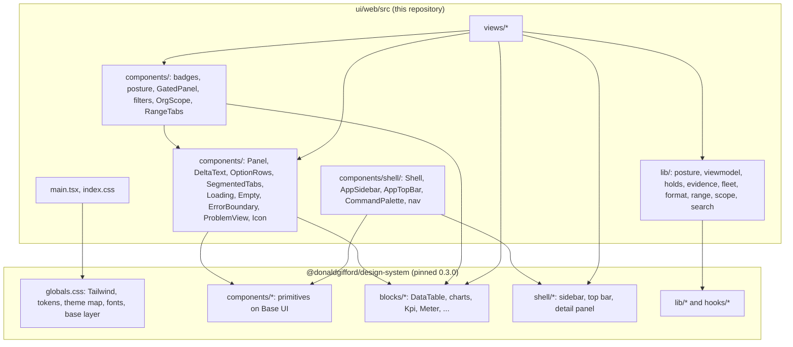
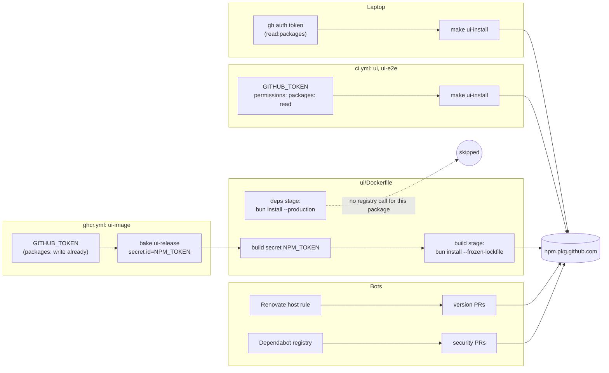
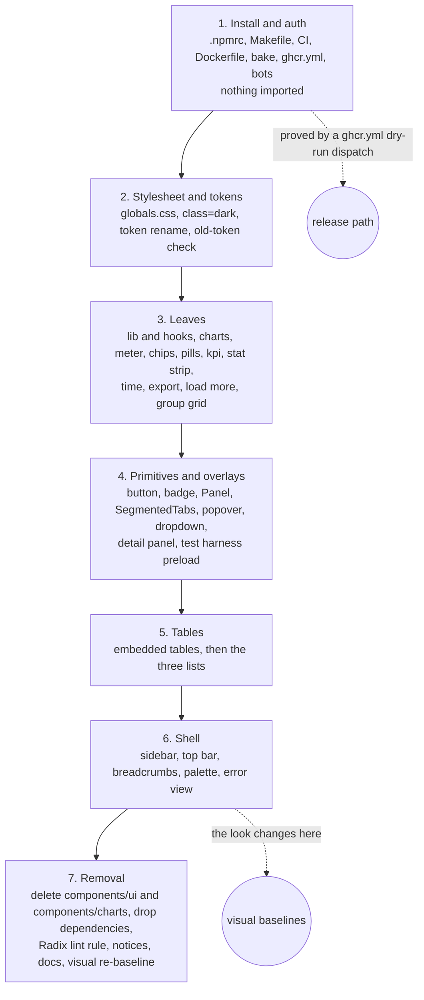

<!-- markdownlint-disable-file MD025 MD041 -->

# DESIGN-0039: Adopting @donaldgifford/design-system in the UI

<!--toc:start-->
<!-- markdownlint-capture -->
<!-- markdownlint-disable MD013 -->
- [Overview](#overview)
- [Goals and Non-Goals](#goals-and-non-goals)
  - [Goals](#goals)
  - [Non-Goals](#non-goals)
- [Background](#background)
- [Detailed Design](#detailed-design)
  - [1. Where the package sits](#1-where-the-package-sits)
  - [2. Dependency and install](#2-dependency-and-install)
  - [3. Stylesheet and tokens](#3-stylesheet-and-tokens)
  - [4. The shell](#4-the-shell)
  - [5. Component dispositions](#5-component-dispositions)
  - [6. Tables](#6-tables)
  - [7. The detail panel](#7-the-detail-panel)
  - [8. Tests and the harness](#8-tests-and-the-harness)
  - [9. What changes for a user](#9-what-changes-for-a-user)
- [API / Interface Changes](#api--interface-changes)
- [Data Model](#data-model)
- [Testing Strategy](#testing-strategy)
- [Migration / Rollout Plan](#migration--rollout-plan)
- [Open Questions](#open-questions)
  - [OQ1: What happens to the mockup?](#oq1-what-happens-to-the-mockup)
  - [OQ2: Does the app offer the light theme?](#oq2-does-the-app-offer-the-light-theme)
  - [OQ3: Is the sidebar's collapsed state remembered?](#oq3-is-the-sidebars-collapsed-state-remembered)
  - [OQ4: What is the sidebar's header?](#oq4-what-is-the-sidebars-header)
  - [OQ5: How does a developer's install get the token?](#oq5-how-does-a-developers-install-get-the-token)
  - [OQ6: How do Renovate and Dependabot reach the package?](#oq6-how-do-renovate-and-dependabot-reach-the-package)
  - [OQ7: Do the embedded tables get a header sort?](#oq7-do-the-embedded-tables-get-a-header-sort)
  - [OQ8: One pull request or several?](#oq8-one-pull-request-or-several)
  - [OQ9: Which release does it cut?](#oq9-which-release-does-it-cut)
- [References](#references)
<!-- markdownlint-restore -->
<!--toc:end-->

<!--docz:overview:start-->
## Overview

The UI stops keeping its own copy of the design. `ui/web` installs
`@donaldgifford/design-system` 0.3.0, takes its stylesheet, tokens,
primitives, blocks and shell from it, and deletes `components/ui`,
`components/charts`, the local shell chrome, the `@theme` in
`index.css` and the `radix-ui` dependency. What stays in this
repository is what knows about repositories, controls, findings and
remediations.

INV-0025 established that this is possible and what it costs. This
document decides how it is done: where the package sits in the build,
how every install path gets its token, what each local file becomes,
what the app looks like afterwards, and the order of the work.

<!--docz:overview:end-->

## Goals and Non-Goals

<!--docz:goals:start-->
### Goals

- `ui/web/src` holds no local copy of anything the package provides.
  `radix-ui`, `recharts`, `clsx`, `tailwind-merge`,
  `class-variance-authority` and the two `@fontsource` packages leave
  `ui/package.json`.
- No utility class or `var()` reads an old token name (`panel`,
  `panel-2`, `ok`, `warn`, `bad`, or `accent` meaning the blue).
- The package is pinned exactly and installs on a laptop, in CI, in
  the image build and for Renovate, with the token never written to a
  file or an image layer.
- Behaviour that users and tests rely on is kept: every route and URL
  parameter, the drawer's `?open=`, dialog and table names, CSV file
  names, the saved time-zone choice, keyboard operation, and the axe
  suite passing unchanged.
- The differences in look are the ones listed in this document and no
  others.
- A problem found in the package becomes an issue on
  `donaldgifford/design-system`, not a patch here.

<!--docz:goals:end-->

<!--docz:non-goals:start-->
### Non-Goals

- No API, BFF, chart or Go change. `ui/server` is untouched.
- No new page, panel, filter or column, and no change to what any page
  shows.
- No light theme (OQ2): the app stays dark only.
- No change to the icon set (INV-0024) or to the `Icon` component.
- No change to the routes' search parsing. The lists do not adopt the
  package's `listSearchSchema` or page-number paging.
- No Storybook in this repository. The package's is the catalog.
- No vendoring or forking of the package.

<!--docz:non-goals:end-->

<!--docz:background:start-->
## Background

DESIGN-0036 gave the v2 UI its design language: one dark theme
declared in `index.css`, shadcn-style primitives hand-copied into
`components/ui`, and chart components over Recharts. DESIGN-0037 added
the controls pages on top. The primitives were kept free of domain
knowledge on purpose, and `@donaldgifford/design-system` 0.1.0 was
made by backporting them and rebuilding them on Base UI. Issue #252
asks this repository to consume that package instead of its own copy.

INV-0025 compared the two, sent 29 gaps and 22 differences upstream
(design-system#11), and tested an install. Its results are the
premises here:

- With 0.3.0 nothing blocks the migration. Every gap was either fixed
  in the package or decided as "stays local".
- The package installs from GitHub Packages, typechecks under this
  repository's compiler flags, builds, passes `check:dist` and builds
  in Docker with a build secret.
- Upstream's rule is that a gap or bug is fixed in the package and a
  design difference is the package's design. Two differences are
  therefore accepted and change how the app looks: the shell and the
  dark destructive red.
- Six things stay local by upstream's decision: `DeltaText`, a card
  wrapper with the `title`/`subtitle`/`right` API, popover option
  rows, the `ErrorBoundary`, inline `Loading`/`Empty`, and the
  options-driven tabs with their URL binding.

What the package is, in one paragraph: React 19, Tailwind v4 with the
theme in CSS, shadcn components on Base UI, Tabler icons, Recharts and
TanStack Table. It publishes TypeScript and CSS source with no build
step, so this app's Vite, Tailwind and `tsc` compile and check it. It
is imported per module (`/components/<name>`, `/blocks/<name>`,
`/shell/<name>`, `/lib/<name>`, `/hooks/<name>`, `/globals.css`), with
no barrel. It is 0.x: a minor release may break.

<!--docz:background:end-->

<!--docz:detailed-design:start-->
## Detailed Design

### 1. Where the package sits



Rules that keep this shape:

- **One direction.** Local code imports the package; nothing local is
  imported by a package path alias, and no file re-exports package
  modules as a local barrel. A call site imports
  `@donaldgifford/design-system/blocks/meter`, not a local `meter`.
- **`components/ui` and `components/charts` cease to exist.** A local
  component that survives lives directly under `components/` and has a
  domain or app reason to exist, written in its header comment.
- **No styling of package internals.** Local code passes `className`
  and props. It does not target a package component's `data-slot` in
  CSS to restyle it; a look that cannot be reached with props is an
  upstream issue.
- **An ESLint rule keeps Radix out.** `no-restricted-imports` bans
  `radix-ui` and `@radix-ui/*` in `ui/web`, beside the existing HTML
  sink ban, so a copied snippet cannot bring it back. (`cmdk` still
  pulls a Radix dialog package in transitively; that is the package's
  dependency, not ours.)

### 2. Dependency and install

`ui/package.json`:

| Change | Entry |
| ------ | ----- |
| add, `devDependencies`, exact | `"@donaldgifford/design-system": "0.3.0"` |
| remove once unused | `radix-ui`, `recharts`, `clsx`, `tailwind-merge`, `class-variance-authority`, `@fontsource/ibm-plex-sans`, `@fontsource/jetbrains-mono` |
| keep | `@tabler/icons-react` (the local `Icon`), `react`, `react-dom`, `tailwindcss`, `@tailwindcss/vite` |

It is a dev dependency because Vite compiles it into the bundle and
the BFF never imports it. That is what lets the image's
production-install stage run with no token (INV-0025 F8). `recharts`
goes because once `components/charts` is deleted nothing here imports
it, and keeping our 3.10.1 beside the package's pinned 3.8.0 bundles
the library twice.

`ui/.npmrc`, committed, holds no secret:

```ini
@donaldgifford:registry=https://npm.pkg.github.com/
//npm.pkg.github.com/:_authToken=${NPM_TOKEN}
```

Every place that installs, and how it gets `NPM_TOKEN`:



| Path | Change |
| ---- | ------ |
| Laptop | `make ui-install` uses `NPM_TOKEN` from the environment and, when it is unset, `gh auth token` (OQ5). `ui/README.md` documents the `read:packages` scope. |
| `ci.yml` `ui`, `ui-e2e` | Each job gains `permissions: { contents: read, packages: read }` and `env: NPM_TOKEN: ${{ secrets.GITHUB_TOKEN }}` on the install step. The workflow default stays `contents: read`. |
| `ui/Dockerfile` | Build stage: `COPY package.json bun.lock .npmrc ./` and `RUN --mount=type=secret,id=NPM_TOKEN NPM_TOKEN="$(cat /run/secrets/NPM_TOKEN)" bun install --frozen-lockfile`. The deps stage is unchanged. The secret is read from its mounted file because the pinned Dockerfile syntax (1.7) has no `env=` on a secret mount. |
| `docker-bake.hcl` | `_ui` gains `secret = ["id=NPM_TOKEN,env=NPM_TOKEN"]`, inherited by `ui-dev`, `ui-ci` and `ui-release`. |
| `Makefile` `docker-build-ui` | Passes `NPM_TOKEN` the same way as `ui-install`. |
| `ghcr.yml` `ui-image` | The bake step gets `env: NPM_TOKEN: ${{ secrets.GITHUB_TOKEN }}`. The job already holds `packages: write`. No change to `ui-image-slsa`, and none to `release.yml`'s permission ceiling. |
| Renovate | A host rule for `npm.pkg.github.com` in `renovate.json5`, reading a Renovate secret, and `:node` added to `extends`. It moves to the shared preset when renovate-config#18 lands (OQ6). |
| Dependabot | The `bun` entry for `/ui` gets a `registries` reference, or its security updates for `/ui` cannot resolve the lockfile (OQ6). |

Three things the release post-mortems make non-negotiable here:

- The token reaches `bun` only through the environment or a secret
  mount, never inlined into a `run:` script from an expression other
  than `secrets.*`.
- After the `ghcr.yml` edit, the `ui-image` job is proved before merge
  with a `workflow_dispatch` of `ghcr.yml` on the branch with
  `dry_run: true`, and the first push-triggered `release.yml` run
  after merge is checked to have created jobs. A green PR does not
  exercise this path.
- `ghcr.yml` and `ecr.yml` are diffed after the edit. `ecr.yml` builds
  no UI image today, so it should not change.

### 3. Stylesheet and tokens

`ui/web/src/index.css` shrinks to the import and the one thing the
package cannot know:

```css
@import "@donaldgifford/design-system/globals.css";
```

`ui/web/index.html` gets `<html lang="en" class="dark">`, because the
package's `:root` is the light theme and `.dark` selects ours. The
five `@fontsource` imports leave `main.tsx`; `globals.css` imports the
same faces.

What happens to each block of today's `index.css`:

| Block | Fate |
| ----- | ---- |
| `@import "tailwindcss"` | from `globals.css` |
| `@theme` colours | deleted; the package's semantic tokens replace them |
| `--breakpoint-nav` (900px) | deleted with the local sidebar; the package shell collapses at 768px |
| `--radius-*`, `--font-*` | deleted; same values in the package |
| `:root { color-scheme: dark }`, `body` | deleted; in the package's base layer |
| `:focus-visible` outline | deleted; the package has the same rule on `--ring` |
| `prefers-reduced-motion` block | deleted; in `globals.css` since 0.2.0 |
| `rg-*` keyframes, `animate-*` utilities | deleted; overlays animate through `tw-animate-css` in the package |

Token names:

| Here today | After | Notes |
| ---------- | ----- | ----- |
| `panel` | `card` | |
| `panel-2` | `muted` | as a hover or recessed surface; see `accent` |
| `ok` / `warn` / `bad` | `success` / `warning` / `destructive` | utilities, `var(--color-*)` and the `Tone` type in `lib/format.ts` |
| `accent` (the blue) | `primary` | focus rings read `ring` |
| `info`, `avatar`, `background`, `foreground`, `muted-foreground`, `border` | unchanged | |

`accent` is the one name that cannot be renamed blindly: in the
package `accent` is a hover surface. All 40 uses are classified by
this rule before any edit:

| The use is | Becomes |
| ---------- | ------- |
| text, icon, link or chart stroke in the brand blue | `primary` |
| a focus ring or outline | `ring` |
| a selected row or pill tint (`bg-accent/12`) | `primary` at the same opacity |
| a hover or pressed surface | `accent` (the package's meaning) |

After the rename, a check in `make lint-ui` greps `ui/web/src` for the
old names (`-panel`, `-ok`, `-warn`, `-bad`, `--color-panel`,
`--color-ok`, `--color-warn`, `--color-bad`) and fails on a hit, so a
later change cannot reintroduce a class that silently generates
nothing. `accent` cannot be checked this way and is covered by review
and the visual baselines.

Chart colours follow the same rule: posture and bucket colours that
mean a status read `--success`/`--warning`/`--destructive`/`--info`;
series colours with no meaning read `--chart-1` to `--chart-5`.

### 4. The shell

The app adopts the package's shell (upstream decision B2). The frame
changes from a top bar over a sidebar to a full-height sidebar beside
the content:

```text
 today                                   after
+--------------------------------------+ +----------+---------------------------+
| = brand            search  tz  (AL)  | | [#] Repo | [<] Fleet / Orgs  srch tz |
+--------+-----------------------------+ | Guardian +---------------------------+
| nav    | breadcrumbs                 | |----------| page header               |
| 220px  | page header                 | | nav      |                           |
|        | ...                         | | 16rem,   | ...                       |
|        |                             | | collapses|                           |
|        |                             | | to rail  |                           |
|        |                             | |----------|                           |
|        |                             | | (AL) Ada |                           |
+--------+-----------------------------+ +----------+---------------------------+
 drawer below 900px                       sheet below 768px
```

Composition, all from package parts:

| Region | Built from | Content |
| ------ | ---------- | ------- |
| Frame | `SidebarProvider`, `SidebarInset` | the provider is controlled; the collapsed state is the app's (OQ3) |
| Sidebar header | `ShellSidebar` `header` | the app identity: `AppMark` with the shield, "Repo Guardian", "compliance · read-only" (OQ4) |
| Navigation | `ShellSidebarGroup`, `SidebarMenuItem`, `SidebarMenuButton render={<Link/>}` | the same groups and entries from `shell/nav.ts`; `isActive` and `aria-current="page"` from the router; `tooltip` is the label, for the rail |
| Nav counts | `SidebarMenuBadge` | Findings and Remediations counts, same sources as today |
| External entry | `SidebarMenuButton render={<a target="_blank"/>}` | Documentation, with the external icon |
| Sidebar footer | `ShellSidebar` `footer`, `DropdownMenu` | the account menu: `AvatarMark` with `initialsOf`, name, subject; Documentation; Sign out |
| Top bar | `TopBarLayout` | `start`: `SidebarTrigger`, a separator, the breadcrumbs. `end`: the Search button with `Kbd`, `TimeZoneToggle` |
| Main | `SidebarInset` | the scrolling column; the 1400px content width and page padding stay local |

Consequences that are behaviour, not look:

- **The breadcrumbs move into the top bar.** They stay one `nav` named
  "Breadcrumb" with the leaf marked `aria-current="page"`, built on
  the package's `Breadcrumb` parts with `BreadcrumbLink render={<Link/>}`.
  `crumbsFor`, `CrumbLabelProvider` and `useCrumbLabel` are unchanged.
- **Sign out stays a POST form** submitted from the menu item, so the
  BFF's Origin check holds. The item uses `onClick`: a Base UI menu
  item has no `onSelect`, and one left in place never fires.
- **The menu label sits inside a `DropdownMenuGroup`**, which Base UI
  requires.
- **The reserved `data-slot="app-switcher"` element goes.** The
  sidebar header is where a portal's switcher would attach.
- **`⌘K` and the sidebar's `⌘B`** are both bound; the palette keeps
  `⌘K`.
- **Below 768px the sidebar is a sheet** opened by the same
  `SidebarTrigger`; `MobileSidebar` and its state in `Shell` go.
- `Shell` still asks `/me` first and renders `AccessView` for a caller
  with no visible org, outside the frame.

`CommandPalette` keeps its data and matching and is rebuilt on
`CommandDialog` with `commandProps={{ shouldFilter: false, loop: true }}`,
`CommandInput`, `CommandGroup` and `CommandItem`.

### 5. Component dispositions

Every local file has one of four fates: **replace** (call sites import
the package module), **rebuild** (the file stays, rewritten on package
parts), **keep**, or **delete**.

Primitives and overlays:

| Local | Fate | Becomes |
| ----- | ---- | ------- |
| `ui/avatar` | replace | `components/avatar`; the menu uses `AvatarMark` |
| `ui/badge` | replace | `components/badge` with `variant`; `Tone` in `lib/format.ts` takes the package's names |
| `ui/button` | replace | `components/button`; the three calls with no `variant` get `variant="outline"`; `<Link><Button tabIndex={-1}>` nestings become `render={<Link/>}` |
| `ui/card` | rebuild | `components/Panel.tsx`: the `title`/`subtitle`/`right`/`bodyClassName` API on `Card render={<section/>}` and `CardTitle render` as an `h3` |
| `ui/tabs` | rebuild | `components/SegmentedTabs.tsx`: `Tabs({label, options, value, onChange})` and `SearchTabs` on the package's `Tabs`/`TabsList`/`TabsTrigger` |
| `ui/table` | delete | unused today |
| `ui/dialog` | delete | only the drawer used it |
| `ui/dropdown-menu` | replace | `components/dropdown-menu` |
| `ui/popover` | replace + rebuild | `components/popover`; the heading, item and separator rows move to `components/OptionRows.tsx` |
| `ui/command` | replace | `components/command` (section 4) |
| `ui/drawer` | delete | the mobile nav is the package sidebar's sheet; the detail drawer is `DetailPanel` |
| `ui/detail-drawer` | replace | `shell/detail-panel` (section 7); `DetailKV` becomes `DetailsGrid layout="list"` |

Blocks and charts:

| Local | Fate | Becomes |
| ----- | ---- | ------- |
| `ui/data-table` | replace | `blocks/data-table` (section 6) |
| `ui/group-grid` | replace | `blocks/group-grid`; `heading`/`label` props, string headers |
| `ui/meter` | replace | `blocks/meter`; `size`, required `label` |
| `ui/chip` | replace | `blocks/filter-chip` |
| `ui/pill` | replace | `blocks/series-pills`; the fleet's hand-rolled series picker uses it too |
| `ui/kpi` | replace + rebuild | `blocks/kpi`; `DeltaText` and `Delta` move to `components/DeltaText.tsx` and go in `hint` |
| `ui/stat-strip` | replace | `blocks/stat-strip`; `subline` becomes `sub` |
| `charts/ChartCard`, `tooltip` | replace | `blocks/chart-card` (`description`, `action`, `strip`) |
| `charts/TrendChart` | replace | `blocks/trend-chart`; `points: {at, value}[]`, `series`; `trendTable(..., { head: "Snapshot", noun: "snapshots" })` |
| `charts/BarBuckets`, `PairBars`, `BarList`, `StackedBars`, `Sparkline`, `DistBar` | replace | the same-named blocks; `DistBar size="sm" label=…` |
| `charts/scale.ts`, `charts/index.ts` | delete | `lib/chart-scale`; no barrel |
| `components/time.tsx`, `lib/time.ts` | replace | `blocks/time`, `lib/time`; `TimeZoneProvider storageKey="rg.tz"` |
| `components/ExportButton.tsx`, `lib/csv.ts` | replace | `blocks/export-button` with `name` and `filename`, `lib/csv` |
| `components/LoadMore.tsx` | replace | `blocks/load-more` |
| `lib/use-media-query.ts` | replace | `hooks/use-media-query`; `SIDE_BY_SIDE` becomes `DETAIL_INLINE_QUERY` |
| `lib/utils.ts` | replace | `lib/utils` |
| `floorPercent`, `formatPercent`, `heatOpacity` | replace | `lib/percent`; `compliantPercent` stays in `lib/format.ts` |

Page, shell and the rest:

| Local | Fate | Becomes |
| ----- | ---- | ------- |
| `page/PageHeader` | replace | `blocks/page-header` (`meta`, `description`, `actions`) |
| `page/Breadcrumbs` | rebuild | on `components/breadcrumb` (section 4) |
| `page/OrgScope`, `page/RangeTabs` | keep | on the package popover and `SegmentedTabs` |
| `shell/Sidebar`, `shell/TopBar` | rebuild | `AppSidebar`, `AppTopBar` on package shell parts |
| `shell/Shell`, `shell/CommandPalette`, `shell/nav.ts` | rebuild / keep | section 4; `nav.ts` unchanged |
| `components/problem.tsx` | rebuild | `ProblemView` adapts a `ProblemError` to the package's `ApiError` and renders `ErrorState`; `ErrorBoundary` stays |
| `components/common.tsx` | keep | `Loading`, `Empty`; the unused `Section` goes |
| `components/icons.tsx` | keep | where a package prop wants a `TablerIcon`, pass the Tabler component, not `<Icon/>` |
| `badges.tsx`, `posture.tsx`, `GatedPanel.tsx`, `filters/*` | keep | rebuilt on the package's `Badge`, `Meter`, `DistBar`, `FilterChip`, popover |
| `views/*`, the rest of `lib/` | keep | call sites change |

The local survivors, each with the reason it is not in the package:

| File | Why local |
| ---- | --------- |
| `Panel.tsx` | a convenience API over about 40 call sites; upstream gave the parts (`render`) and left the wrapper to the app |
| `SegmentedTabs.tsx` | panel-less tabs driven by options and bound to a URL parameter; router code |
| `OptionRows.tsx` | upstream: local until a second app needs option rows in a popover |
| `DeltaText.tsx` | upstream: local, passed as `Kpi`'s `hint` |
| `common.tsx` | inline "Loading…" and an in-card empty line; the package's are page-sized |
| `problem.tsx` | the boundary, and the adapter from this API's problem type |
| `icons.tsx` | the app's named icon set over Tabler (INV-0024) |

### 6. Tables

One call shape for the 14 embedded tables and one for the three
cursor-paged lists. Neither passes `search`, so the routes keep their
own `validateSearch` and the table renders no filter, row count or
pager.

```tsx
// embedded, inside a Panel
<DataTable sortable={false} bare label="Org controls" columns={controlColumns} data={o.controls}
  getRowId={(c) => `${c.control_id}/${c.decision}`} empty="No control is assigned here." />

// a list: the server filters, sorts and pages by cursor
<DataTable manual bare label="Findings" columns={columns} data={items}
  getRowId={findingKey} selectedId={open} onRowClick={(r) => openFinding(findingKey(r))}
  compact={inline} />
<LoadMore loaded={items.length} total={total} hasMore={…} loading={…} onMore={…} noun="findings" />
```

- Columns are written with `dataTableColumns<T>()`. `width` and
  `className` become `meta.className`; `numeric` and `hideBelow` are
  `meta` keys with the same values.
- A `manual` table with no `onSearchChange` has sorting off (0.2.1),
  which is what the lists need: their sort is a closed enum chosen
  with the Sort tabs.
- Embedded tables pass `sortable={false}` (0.3.0): plain-text headers,
  no sort button, no `aria-sort` (OQ7).
- Row activation keeps today's semantics in the package: a click or
  key from a link or button inside the row does not open the drawer,
  and Space activates.
- The focus-return lookup changes from `tr[data-key="…"]` to
  `tr[data-row-id="…"]`.

### 7. The detail panel

`FindingDrawer` and `RemediationDrawer` render `DetailPanel`:

| Today | After |
| ----- | ----- |
| `onClose` | `onOpenChange={(o) => { if (!o) close(); }}` |
| `subtitle` | `description` |
| `aria-label="Finding: acme/web renovate"` | `label="Finding: acme/web renovate"`; the name is the same in both forms |
| refocus on a new row while inline | `subject={open}` |
| `inline`, `returnFocusTo`, `footer` | unchanged |
| `DetailKV rows=[{key, value}]` | `DetailsGrid layout="list" items=[{label, value}]` |
| page grid `grid-cols-[minmax(0,1fr)_470px]` | the second column is `var(--sheet-width-wide)` (36rem) |

The overlay form is the package's sheet: 36rem wide, 200ms. The
1600px side-by-side threshold is unchanged.

### 8. Tests and the harness

- `web/testing/dom.ts` preloads Base UI and `cmdk` where it preloads
  `radix-ui` today. Both decide at module load whether a document
  exists, which is the failure that file exists to prevent.
- The unit tests of deleted components go with them: three files under
  `components/ui`, `charts.test.tsx`, and the tests of `time`, `csv`
  and `export` for code that now lives in the package and is tested
  there. Tests of local behaviour stay and are rewritten against the
  new markup: the palette, the shell, the page header and breadcrumbs,
  the filters, the gated panels, the badges, and every view test.
- Tests query by role and name. A test that reads a Radix `data-state`
  or a tag name (`b[aria-current=page]`) is rewritten to a role or an
  ARIA attribute, so the next change of primitive does not break it.

### 9. What changes for a user

Accepted differences, complete:

| Area | Change |
| ---- | ------ |
| Frame | full-height sidebar with the app identity on top and the account menu at the foot; the top bar holds the collapse trigger, breadcrumbs, search and time zone |
| Sidebar | 16rem wide (was 220px); collapses to an icon rail; a sheet below 768px (was a drawer below 900px) |
| Colour | dark destructive red is lighter (`#f7756e`, was `#f2554d`) and now passes 4.5:1 on every surface; other colours move by at most two units per channel |
| Detail panel | 36rem wide (was 470px); the key and value list is the package's list layout |
| Tables | head and row heights from the package's tokens |
| Time zone | two pressed buttons instead of a radio pair |
| Small text | chart-card toggle reads "Table"; breadcrumb leaf is not bold |

Not changed: page content and order, URLs, filters, keyboard paths,
accessible names of dialogs and tables, CSV names and contents, the
saved time zone.

<!--docz:detailed-design:end-->

<!--docz:api-changes:start-->
## API / Interface Changes

No HTTP API, BFF route, chart value or environment variable of the
running service changes.

| Surface | Change |
| ------- | ------ |
| Build environment | `NPM_TOKEN` is required to install `ui/` dependencies (laptop, CI, image build). It is a build-time credential with `read:packages` and never reaches the runtime image. |
| `ui/.npmrc` | new, committed, holds only the `${NPM_TOKEN}` reference |
| `docker-bake.hcl` | the UI targets declare the `NPM_TOKEN` secret; `docker buildx bake ui-dev` without it fails at install |
| Browser storage | `rg.tz` is kept (passed as `storageKey`). One new key holds the sidebar's collapsed state (OQ3). |
| URLs | none |
| CSS custom properties | `--color-panel`, `--color-panel-2`, `--color-ok`, `--color-warn`, `--color-bad` no longer exist. Nothing outside `ui/web` reads them. |
| Image contents | `THIRD_PARTY_NOTICES.md` gains the package (Apache-2.0) and the libraries now bundled through it (Base UI, TanStack Table, cmdk, sonner, tw-animate-css, zod: all MIT); the fonts entry notes they arrive through the package |

<!--docz:api-changes:end-->

<!--docz:data-model:start-->
## Data Model

None. No schema, query or stored value changes.

<!--docz:data-model:end-->

<!--docz:testing:start-->
## Testing Strategy

| Layer | What it proves | Change |
| ----- | -------------- | ------ |
| `tsc` (`make lint-ui`) | the package's source and every call site typecheck under this repository's flags | none to the flags; the package is checked because it ships source |
| ESLint | no `radix-ui` import, no HTML sink | one new restricted import |
| Old-token check (`make lint-ui`) | no utility or `var()` reads a removed token name | new script beside `check:dist` |
| `check:dist` | the build has no `data:` URI and fits the CSP | unchanged; must pass with the package's fonts |
| Bun unit tests | local behaviour: palette matching, nav, breadcrumbs, filters, gated panels, view models | rewritten against roles; component tests that moved upstream are deleted |
| Playwright `ui.spec.ts`, `no-remediation.spec.ts` | every page, both projects, the two-org visibility assertions | selectors that named local markup move to roles; the assertions do not weaken |
| Playwright `a11y.spec.ts` (axe) | contrast, names, nesting | must pass with no rule disabled and no new exclusion |
| Playwright `visual.spec.ts` | the look | all four baselines are regenerated once, in the pinned image, in the same change that swaps the shell, and reviewed as images |
| Docker build | the image builds with the secret and the runtime image has no token | `make docker-build-ui` locally; a `ghcr.yml` dry-run dispatch on the branch |

Rules for the migration's own tests:

- **A stage is green before the next starts.** `make lint-ui`,
  `make test-ui` and `make test-ui-e2e` pass at the end of every stage
  in the rollout below, so a regression is attributed to one stage.
- **The visual baselines move twice at most**: once after the token
  swap if the colour shift exceeds the comparison threshold, and once
  after the shell. Any other stage that changes a screenshot has
  changed the look by accident and is fixed, not re-baselined.
- **A rewritten test is shown to fail first.** For each e2e assertion
  whose selector changes, the new selector is run against the old
  build or with the behaviour removed, so a selector that matches
  nothing cannot pass as a kept guarantee.
- **Keyboard checks are explicit**, because Base UI replaces every
  overlay: focus lands inside each overlay on open, returns to the row
  or trigger on close, Escape closes, and the row is activatable with
  Enter and Space. These exist in `ui.spec.ts` and
  `behaviour.test.tsx` today and are kept as behaviours.

<!--docz:testing:end-->

<!--docz:rollout:start-->
## Migration / Rollout Plan

The work is seven stages. The order is chosen so the app builds,
passes and looks deliberate after each one.



| Stage | Looks | Exit check |
| ----- | ----- | ---------- |
| 1 | identical | CI installs with `GITHUB_TOKEN`; `make docker-build-ui` builds; the `ghcr.yml` dry run builds the UI image |
| 2 | the same within the colour shift (the red is visibly lighter) | no old token name left; axe passes; local components still in place |
| 3 | the same | charts, meters and strips render from the package; chart unit tests deleted with their components |
| 4 | the same, overlays at 200ms | no file imports `radix-ui`; keyboard checks pass |
| 5 | the same, table heights from the package | `components/ui/data-table` has no importer |
| 6 | the new frame | every e2e passes on the new shell; baselines regenerated and reviewed |
| 7 | the same as 6 | `components/ui` and `components/charts` are gone; the dependency list matches section 2 |

How it ships:

- One implementation plan, one pull request, with the stages as its
  phases (OQ8). The intermediate states exist as commits, not as
  releases.
- The pull request carries a semver label, so merging it cuts a
  release (OQ9), with a `ui/CHANGELOG.yaml` entry and the chart
  `appVersion` bump in the same change.
- Rollback is a revert of the merge. Nothing persistent changes: the
  one new browser storage key is ignored by the old build.
- The package is pinned exactly. A later update is a Renovate pull
  request that runs the whole suite including the visual comparison,
  because a 0.x minor may change look or API.

Documents updated in the same change: `CLAUDE.md` (§The UI: the
package, the token, the local survivors, the dom preload),
`ui/README.md` (setup and the token section), DESIGN-0036 (a note that
its token and shell sections are superseded by this design). The
mockup (`ui/design/repo-guardian-mockup.html`) is already redrawn in
this design's pull request: its `:root` values are the package's dark
theme and its frame is the package shell (OQ1).

Risks:

| Risk | Handling |
| ---- | -------- |
| `GITHUB_TOKEN` cannot read another repository's package in CI, or in a pull request from a fork | proved in stage 1 before anything depends on it; the fallback is a repository secret holding a `read:packages` token |
| The release pipeline fails silently after the `ghcr.yml` edit | dry-run dispatch before merge; check the first push-triggered run creates jobs |
| A 0.x release breaks the app | exact pin; updates only through a reviewed pull request with the full suite |
| A gap appears mid-migration | an upstream issue; the stage waits or the local file stays one more stage. No local patch of package internals |
| Bundle growth | measured at stage 7 against `main` (989 kB JS, 31 kB CSS); the spike's 1,761 kB was every module with nothing deleted |
| The package registry is unreachable | installs fail closed; the lockfile and Bun's cache cover CI reruns only partly. Accepted: the same holds for npm |

<!--docz:rollout:end-->

<!--docz:open-questions:start-->
## Open Questions

All nine were decided on 2026-11-17; each decision is recorded under
its question. Option (a) was the recommendation in each.

### OQ1: What happens to the mockup?

`ui/design/repo-guardian-mockup.html` is the UI's reference and
carries its own copy of the tokens and the shell. The standing rule is
that a UI design is accepted together with its mockup. It has not been
edited yet, pending this answer.

- **(a)** ✅ recommended: update the mockup in this design's pull
  request, limited to the frame (the package shell) and the token
  values, and keep it as the reference for page composition. Follows
  the standing rule; the pages are the part Storybook does not show.
- **(b)** Retire the mockup. The package's Storybook is the reference
  for components and shell, the running app for pages. Removes a
  second hand-kept copy of the design, which is what this migration is
  for, but leaves no place to draw a page before building it.
- **(c)** Freeze it with a banner saying the frame and tokens are out
  of date. Cheapest, and leaves a reference known to be wrong.
- **other:**

**Decision:** (a), 2026-11-17. The mockup's frame and token values are redrawn in this design's pull request; it stays the reference for page composition.

### OQ2: Does the app offer the light theme?

The package ships both themes; the app is dark-only today.

- **(a)** ✅ recommended: dark only, `class="dark"` fixed on `<html>`.
  Keeps this change a migration; a light theme doubles the visual
  baselines and needs every status colour and chart checked.
- **(b)** Add a theme toggle with a stored choice in this work. The
  package makes it cheap to switch, but not to verify.
- **(c)** Follow the operating system's preference with no toggle.
  Changes what many users see on the day of the upgrade.
- **other:**

**Decision:** (a), 2026-11-17. Dark only.

### OQ3: Is the sidebar's collapsed state remembered?

The package's provider is controlled and leaves persistence to the
app.

- **(a)** ✅ recommended: remember it in `localStorage` under
  `rg.sidebar`, beside `rg.tz`. A user who collapses it expects it to
  stay collapsed.
- **(b)** Do not remember it; it opens expanded on every load. No new
  storage key, at the cost of the preference.
- **(c)** Keep it in the URL. Shareable, but it is a personal
  preference and would ride along in every copied link.
- **other:**

**Decision:** (a), 2026-11-17. `localStorage` key `rg.sidebar`.

### OQ4: What is the sidebar's header?

The package's `ShellSidebarIdentity` always draws the up-down chevrons
of a menu, and there is no second app to switch to.

- **(a)** ✅ recommended: a link to `/` built from `SidebarMenuButton`
  and `AppMark` with the title and subtitle, without
  `ShellSidebarIdentity`, so no chevron promises a menu that is not
  there.
- **(b)** Use `ShellSidebarIdentity` in a menu with one entry, as the
  package's story does. Matches the catalog exactly and shows a menu
  with nothing to choose.
- **(c)** Ask upstream for an identity without the chevron and wait
  for it. The cleanest result, and it blocks the shell stage on a
  release.
- **other:**

**Decision:** (a), 2026-11-17. A link to `/` with the mark, title and subtitle, and no menu chevron.

### OQ5: How does a developer's install get the token?

- **(a)** ✅ recommended: `make ui-install` and `make docker-build-ui`
  use `NPM_TOKEN` when set and otherwise `gh auth token`. One less
  setup step for anyone already using `gh`; CI always sets the
  variable, so the fallback never runs there.
- **(b)** Require `NPM_TOKEN` to be exported, and fail with a message
  naming the README section. Explicit, and one more thing to set up.
- **(c)** Read it from a mise environment file kept out of git.
  Automatic once set, and puts a token in a file on disk.
- **other:**

**Decision:** (a), 2026-11-17. `NPM_TOKEN` when set, otherwise `gh auth token`.

### OQ6: How do Renovate and Dependabot reach the package?

Both need a token for `npm.pkg.github.com`, and both take it from a
secret only a maintainer can set. Without it, Renovate does not see
new versions and Dependabot's security updates for `/ui` may fail to
resolve the lockfile.

- **(a)** ✅ recommended: add a Renovate `hostRules` entry in
  `renovate.json5` and a Dependabot `registries` entry, each reading a
  secret the maintainer creates (a `read:packages` token). The tasks
  are marked "deferred - human required"; until then the pin is bumped
  by hand.
- **(b)** Put the host rule in the shared `donaldgifford/renovate-config`
  preset, since every consumer of the package needs it. Right place in
  the long run, a change in another repository now.
- **(c)** Configure neither; bump the package by hand and accept that
  Dependabot's `/ui` security updates may fail. No secret to manage,
  and a 0.x dependency that silently goes stale.
- **other:**

**Decision:** (a) now, and (b) as the destination, 2026-11-17. This repository adds its own host rule and Dependabot registry entry, both reading a maintainer-created secret. The shared preset is requested in [renovate-config#18](https://github.com/donaldgifford/renovate-config/issues/18), because other apps will consume the package; when it lands, `renovate.json5` here extends it and drops its own host rule.

### OQ7: Do the embedded tables get a header sort?

The package's plain table sorts on a header click. Today no table
here does.

- **(a)** ✅ recommended: off for now (sorting disabled on embedded
  tables' columns). Keeps the change a migration and keeps orders that
  mean something, such as worst controls first.
- **(b)** On everywhere. A free feature on small tables, with new
  behaviour to test on 14 tables and some orders that should not be
  rearranged.
- **(c)** On only where the order has no meaning (catalogue,
  exclusions, events). The most useful, and needs a decision per
  table.
- **other:**

**Decision:** (a), 2026-11-17. Sorting is off on embedded tables, with
the `sortable={false}` prop the package added in 0.3.0 for this.

### OQ8: One pull request or several?

- **(a)** ✅ recommended: one implementation plan and one pull
  request, the seven stages as phases. The standing practice; the
  intermediate states are not worth releasing, and the release path is
  proved before merge by the dry-run dispatch.
- **(b)** Two: stage 1 (install and auth) first, labelled
  `dont-release`, then the rest. Proves CI and the image build on
  `main` before the large change depends on them, for one extra merge.
- **(c)** One per stage. Smallest reviews, seven merges, and several
  releases of a half-migrated UI unless each is `dont-release`.
- **other:**

**Decision:** (a), 2026-11-17. One implementation plan, one pull request.

### OQ9: Which release does it cut?

`main` is at 2.0.0.

- **(a)** ✅ recommended: `minor`, which tags v2.1.0. The UI looks
  different and nothing breaks for an operator: no value, variable or
  API changes.
- **(b)** `patch`, v2.0.1. Understates a visible change of frame.
- **(c)** `dont-release`, shipping with the next feature release.
  Leaves `main` ahead of the last release by a large UI change.
- **other:**

**Decision:** (a), 2026-11-17. `minor`, which tags v2.1.0.

<!--docz:open-questions:end-->

<!--docz:references:start-->
## References

- Issue [#252](https://github.com/donaldgifford/repo-guardian/issues/252),
  the brief
- [INV-0025](../investigation/0025-migrating-the-ui-to-the-shared-donaldgifforddesign-system.md),
  the investigation this design rests on
- [design-system#11](https://github.com/donaldgifford/design-system/issues/11),
  the gaps and differences and upstream's decision on each
- [`donaldgifford/design-system`](https://github.com/donaldgifford/design-system),
  its README (imports, tokens, "Coming from Radix-based shadcn", change
  policy) and the
  [Storybook catalog](https://donaldgifford.github.io/design-system/)
- [DESIGN-0036](0036-frontend-design-cleanup-and-refresh-for-the-v2-ui.md),
  the design language this replaces in part, and
  [DESIGN-0037](0037-controls-ui-org-tree-findings-fleet-panels-and-status-changelog.md),
  the pages that are kept
- [INV-0024](../investigation/0024-icon-set-for-the-ui.md), the icon
  set
- [renovate-config#18](https://github.com/donaldgifford/renovate-config/issues/18),
  the shared preset for the `@donaldgifford` scope on GitHub Packages
- [The mockup](https://github.com/donaldgifford/repo-guardian/blob/main/ui/design/repo-guardian-mockup.html), redrawn with
  this design

<!--docz:references:end-->
