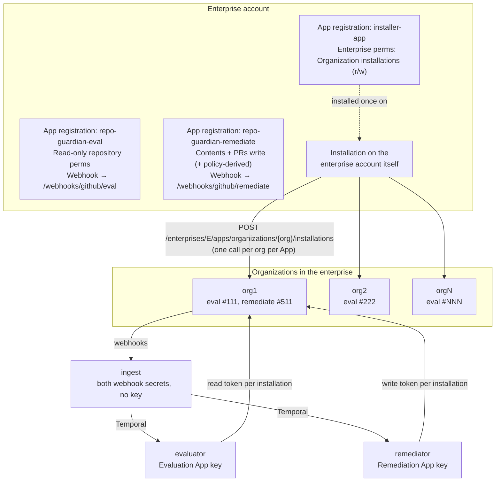
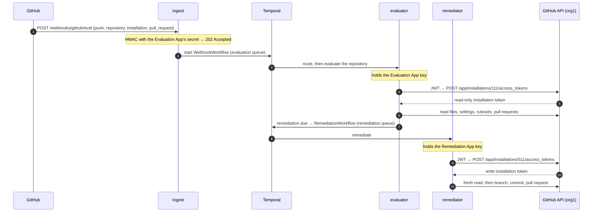

# repo-guardian GitHub Apps — Enterprise Setup Guide

How to register, install, and run repo-guardian's two GitHub Apps as
**enterprise-owned Apps** across N organizations in a GitHub Enterprise
Cloud account. Two registrations, one private key each, N installations
of each. Per-org credentials were investigated and deferred
([INV-0006](../investigation/0006-per-org-github-app-credentials.md)):
every organization shares the same two keys.

Companion docs: [Turning on repo-guardian v2](v2-onboarding.md) covers
the whole install, including the permission and event tables this page
repeats; [Scaling repo-guardian](scaling.md) covers sizing for
multi-org fleets; [Running repo-guardian on AWS](aws.md) covers the
infrastructure underneath.

## The two Apps

repo-guardian v2 runs as two GitHub Apps. The private key is the
security boundary: a process holding a write-capable key can mint a
write token whatever it intends, so the evaluator holds a key that
cannot write.

| | Evaluation App | Remediation App |
| --- | --- | --- |
| Access | read-only | writes: branches, commits, pull requests, and the API resources of `direct` controls |
| Install on | every organization in `enterprise.orgs` | organizations with any `remediate` assignment |
| Key held by | evaluator pods (and `all`) | remediator pods (and `all`) |
| Webhook URL | `POST /webhooks/github/eval` | `POST /webhooks/github/remediate` |
| Chart values | `github.eval.*` | `github.remediate.*` |
| Rate budget | `installation/eval/<installation id>` | `installation/remediate/<installation id>` |

The Remediation App is optional until an organization remediates. Until
it can reach a repository, every assignment on that repository runs in
`evaluate`, with reason `remediation_app_no_access`, whatever the policy
asks for.

## The model in one diagram

Registration and installation are separate things. The **enterprise
account owns each registration** (name, private key, permissions,
webhook config); ownership grants no access. **Installations** are the
per-org grants: each one gives that App its permissions on that org
only, with its own installation ID and its own rate-limit budget.



Key properties of this shape:

- **One registration per App, N installations each.** Each worker holds
  one App ID and one private key; `ghinstallation` mints short-lived
  per-installation tokens on demand, and installation clients are
  cached per installation ID.
- **The service's configuration is oblivious to enterprise ownership.**
  There is no enterprise token, endpoint or mode in the binary or the
  chart. The deployment uses the same values as a single-org install
  (`github.eval.*`, `github.remediate.*`), pointing at the
  enterprise-owned registrations. Enterprise ownership matters at
  registration time (Steps 1–2) and install time (Step 4), and the
  service takes part in neither.
- **Per-installation, per-App rate budgets.** Each org's installation of
  each App has its own budget: 5,000 requests an hour baseline, scaling
  with repository and user count up to 12,500, and a flat 15,000 for
  installations on GitHub Enterprise Cloud orgs. One busy org cannot
  spend another's budget, and remediation cannot spend evaluation's.
  [The GitHub rate budget](scaling.md#the-github-rate-budget) has the
  math.
- **Enterprise permissions live on a separate installer App** with a
  separate key. A leaked repo-guardian key can touch what that App's
  permissions grant; it can never install anything anywhere.
- Enterprise-owned Apps can only be installed on the enterprise or orgs
  within it, so there is no "accidentally public" failure mode.
- Permission changes an enterprise owner makes on a registration are
  **auto-accepted by every org installation**, so adding a permission
  for a new `direct` control needs no per-org approval.

## Step 1 — Register the Evaluation App

1. Go to `https://github.com/enterprises/<ENTERPRISE>/settings/apps` →
   **New GitHub App**.
2. Settings:
   - **Name:** for example `repo-guardian-eval`.
   - **Homepage URL:** this repo's URL (required field).
   - **Webhook:** **Active**. **Webhook URL:**
     `https://<your host>/webhooks/github/eval`. Ingress is
     operator-owned; pick an option from [ingress.md](ingress.md) (see
     the ordering note below). **Webhook secret:** a strong random
     value; it becomes `github.eval.webhookSecret`, or the
     `webhook-secret` key of `github.eval.existingSecret`.
   - **Expire user authorization tokens:** deselect (repo-guardian
     never signs in users).
   - **Permissions:** the table below.
   - **Subscribe to events:** **Push**, **Repository**, **Installation
     repositories** and **Pull request**. Installation events are
     delivered to every App webhook without a subscription.
   - **Enterprise permissions:** none.
3. Create the App. Record the **App ID** (→ `github.eval.appId`) and
   the **Client ID** (used by the Step 4 install loop).
4. **Generate a private key.** The `.pem` becomes the `private-key` key
   of `github.eval.existingSecret` (or `github.eval.privateKey` for a
   quick trial). Store it in your secrets backend, never in a repo or on
   a laptop.

### Evaluation App permissions

Read-only, and fixed. The evaluator logs this set at startup:

```json
{"level":"INFO","msg":"Evaluation App permissions required","app":"eval","permissions":["Metadata: read","Contents: read","Pull requests: read","Administration: read","Custom properties (organization): read"]}
```

| Permission | Access | Needed for |
| --- | --- | --- |
| Repository → **Metadata** | Read | always (mandatory); rulesets and custom property values |
| Repository → **Contents** | Read | every file-based control |
| Repository → **Pull requests** | Read | pull requests and labels |
| Repository → **Administration** | Read | `security_and_analysis` and the vulnerability-alerts read (`repo_settings`) |
| Organization → **Custom properties** | Read | the organization's property schema (`custom_properties`) |

What each event does is in
[Evaluation App events](v2-onboarding.md#evaluation-app-events).

## Step 2 — Register the Remediation App

Same flow, with these differences:

- **Name:** for example `repo-guardian-remediate`.
- **Webhook URL:** `https://<your host>/webhooks/github/remediate`, with
  its **own** webhook secret (→ `github.remediate.webhookSecret`, or
  the `webhook-secret` key of `github.remediate.existingSecret`).
- **Subscribe to events:** **Installation repositories** only. The
  Remediation App's events describe where it may write, not which
  repositories exist, so they never start discovery
  ([Remediation App events](v2-onboarding.md#remediation-app-events)).
- Record the App ID (→ `github.remediate.appId`) and the Client ID, and
  generate its private key (→ the `private-key` key of
  `github.remediate.existingSecret`).

### Remediation App permissions

The Remediation App's set is **derived from the policy**. The
remediator computes it from every control the loaded policy defines
and logs it at startup, right after resolving its bot user:

```json
{"level":"INFO","msg":"Remediation App permissions required","app":"remediate","permissions":["Contents: write","Metadata: read","Pull requests: write"]}
```

Compare the installation against that line after every policy change
that adds a control. The base set, always required:

| Permission | Access | Needed for |
| --- | --- | --- |
| Repository → **Metadata** | Read | always (mandatory) |
| Repository → **Contents** | Read & write | every file-based control |
| Repository → **Pull requests** | Read & write | every remediation pull request |

Write on each resource a control writes directly
(`remediation { apply = "direct" }`). A `recommend` control (the default
for API types) writes nothing, so it needs no write permission:

| Permission | Access | Control types |
| --- | --- | --- |
| Repository → **Administration** | Read & write | `repo_settings`, `branch_ruleset` with `apply = "direct"` |
| Repository → **Custom properties** | Read & write | `custom_properties` with `apply = "direct"` |
| Repository → **Issues** | Read & write | `labels` with `apply = "direct"` |
| Repository → **Workflows** | Read & write | only when a control writes under `.github/workflows/`: `custom_properties` with `apply = "workflow"`, or a file control whose file lives there. GitHub refuses those commits on Contents write alone; without it the control is held with `hold = permission` |

> [!NOTE]
> **Ordering (webhook URL chicken-and-egg).** The registration form
> requires a webhook URL when the webhook is active, but you need the
> App IDs and keys to deploy the service that serves those URLs.
> Register with the *planned* URLs, deploy the chart with the recorded
> credentials, then confirm delivery under each App's **Advanced →
> Recent Deliveries** tab. Deliveries that fired before the service was
> up can be redelivered from there, or ignored: discovery converges on
> anything missed. The registrations alone can do nothing anywhere;
> access only materializes in Step 4.

## Step 3 — Installer App (reuse if it exists)

The installer App is what turns "install into N orgs" from a clickfest
into a loop. **Check whether one already exists** at
`https://github.com/enterprises/<ENTERPRISE>/settings/apps`. If yes,
skip to Step 4.

> [!NOTE]
> **Do you actually need a third App?** Strictly, no. Install
> repo-guardian's Apps into each org by hand (org settings → the App's
> Install page), which is fine at a handful of orgs and a clickfest at
> 20+. Or give one of repo-guardian's own registrations the enterprise
> permission and run the Step 4 loop with its key.
>
> Don't do the combined shape. **Enterprise organization installations:
> write** installs "**any valid GitHub App**" (GitHub's wording, not
> limited to enterprise-owned Apps) into any org: a leaked key holding
> it lets an attacker install an App *they* control across the whole
> enterprise. repo-guardian's keys are **hot**, mounted in pods and used
> on every evaluation. The installer key is **cold**: used for minutes
> at onboarding, then back in the vault, and reused for every future
> enterprise App. Keep the escalation primitive out of the runtime
> credentials.

If not:

1. Same **New GitHub App** flow. Name it `<enterprise>-installer` per
   convention.
2. Webhook inactive, no repository permissions, no organization
   permissions.
3. **Enterprise permissions:** **Enterprise organization installations
   → Read and write**. This is the one permission that authorizes
   installing Apps into member orgs.
4. Create, record the Client ID, generate and store the private key.
5. In the App's sidebar → **Install App** → install it **on the
   enterprise account itself**. Note the installation ID from the
   resulting URL
   (`/enterprises/<ENTERPRISE>/settings/installations/<ID>`).

## Step 4 — Install the Apps into the orgs

Authenticate the installer App, then loop the install endpoint over the
org list, once per App:

```bash
# 1. JWT for the installer App (client ID + its private key)
INSTALLER_JWT=$(gen-jwt.sh "$INSTALLER_CLIENT_ID" installer.private-key.pem)

# 2. Exchange the JWT for an enterprise-scoped installation token
INSTALLER_TOKEN=$(gh api --method POST \
  "/app/installations/${INSTALLER_INSTALL_ID}/access_tokens" \
  --header "Authorization: Bearer ${INSTALLER_JWT}" --jq .token)

# 3. Install an App into each org in a list
install() { # $1 = client ID of the App, $2 = file of org names
  for ORG in $(cat "$2"); do
    gh api --method POST \
      "/enterprises/${ENTERPRISE}/apps/organizations/${ORG}/installations" \
      --header "Authorization: Bearer ${INSTALLER_TOKEN}" \
      --header "X-GitHub-Api-Version: 2022-11-28" \
      --field "client_id=$1" \
      --field "repository_selection=all"
  done
}

install "$EVAL_CLIENT_ID" orgs.txt                 # every org in enterprise.orgs
install "$REMEDIATE_CLIENT_ID" remediate-orgs.txt  # orgs that remediate
```

Notes:

- The endpoint takes the **client ID of the App being installed**: the
  installer token authorizes the act, the client ID says which App.
- **Install the Evaluation App with `repository_selection=all`.** It is
  an org-compliance tool, and `all` means new repositories are covered
  automatically. Exclusions belong in the policy (`exclude_repos` and
  `exclude` blocks in `orgs/<org>.hcl`, see the
  [policy reference](../usage/policy-reference.md#orgshcl)), not in the
  installation's repository selection: the policy is visible and
  versioned, a `selected` installation is invisible drift.
- **The Remediation App's selection is a write boundary.** Installing it
  on `all` repositories and letting the policy's `mode = "remediate"`
  decide is the simple shape. A `selected` installation is a legitimate
  hard limit on where repo-guardian can ever write: repositories outside
  it stay in `evaluate` with reason `remediation_app_no_access`.
- The call is effectively idempotent: an org that already has the
  installation returns an "already installed" error, which the loop can
  treat as success.
- Each Evaluation App install fires an `installation.created` webhook
  at the running service, which starts a discovery run for that
  installation. Each managed repository gets its own evaluation
  workflow, and first evaluations are spread across `evalInterval`, so a
  200-org rollout does not evaluate everything at once.
- An org must also be in `enterprise.orgs`. An installed org that is
  not in the list is discovered but `unmanaged`: nothing is evaluated on
  it. Roll the policy change out first
  ([Onboarding organisations](v2-onboarding.md#onboarding-organisations-and-repositories)).

## Step 5 — Verify

Spot-check the UI at
`https://github.com/organizations/<ORG>/settings/installations`; both
Apps should be listed where you installed them. Programmatically, with
each App's own credentials:

```bash
EVAL_JWT=$(gen-jwt.sh "$EVAL_CLIENT_ID" repo-guardian-eval.private-key.pem)
gh api "/orgs/${ORG}/installation" \
  --header "Authorization: Bearer ${EVAL_JWT}" --jq .id
```

Then verify the service side:

```bash
# Webhook deliveries landing on ingest
kubectl logs -n repo-guardian deploy/repo-guardian-ingest | grep installation

# The permission sets each worker expects
kubectl logs -n repo-guardian deploy/repo-guardian-evaluator  | grep 'permissions required'
kubectl logs -n repo-guardian deploy/repo-guardian-remediator | grep 'permissions required'

# Repositories discovered per org
psql "$STORE_DSN" -c \
  "SELECT org, count(*) FILTER (WHERE active) AS active, count(*) AS total
   FROM repositories GROUP BY org ORDER BY org;"

# Evaluations per org on the metrics endpoint
curl -s localhost:9090/metrics | grep 'repo_guardian_evaluations_total{'
```

Every org in `orgs.txt` should appear in `repositories` once discovery
has run for it. The `controls-discovery` Schedule (`discovery.interval`,
default 1h) enumerates every installation and backfills anything a
webhook missed, so a gap self-heals. A *persistently* missing org means
its installation does not exist, or the org is not in
`enterprise.orgs`.

**Start in `evaluate`.** A new install writes nothing to GitHub until an
assignment is in `mode = "remediate"` on a repository the Remediation
App can reach. At N orgs the first remediation is the largest pull
request burst the fleet will see, so turn it on one organization at a
time ([Turning on remediation](v2-onboarding.md#turning-on-remediation)).

## Step 6 — How repo-guardian authenticates at runtime



Implementation notes:

- The `go-github` + `ghinstallation` transport handles the JWT and token
  exchange; the binary never persists tokens.
- Installation clients are cached per installation ID, so token minting
  and rate-limit accounting are per org, per App.
- Ingest holds both webhook secrets and both App IDs and no key. Each
  route checks only its own App's secret and refuses an installation
  event naming the other App's ID (401,
  `webhook_rejected_total{reason="app_mismatch"}`).
- Scheduled work follows the same path minus the webhook: each
  repository's evaluation workflow wakes on its own timer every
  `evalInterval`, and the hourly `remediation-sweep` starts due
  remediations.
- The remediator refuses to start without its bot user: at startup it
  resolves the Remediation App's bot account (`GET /app`, then the
  `<slug>[bot]` user) and logs `remediation app bot user`. Only pull
  requests that bot authored are adopted as repo-guardian's own.

## Ongoing operations

**New orgs.** Joining the enterprise installs nothing. Onboarding is:
add the org to `enterprise.orgs` (and `orgs/<org>.hcl` if it needs its
own layer) and roll that policy out, then run the Step 4 loop for the
org. Discovery takes it from there.

**Key rotation.** GitHub App registrations support two private keys at
once: generate the new key, update the Secret behind
`github.eval.existingSecret` (or `github.remediate.existingSecret`),
roll that role's Deployment, confirm clean evaluations or remediations,
then delete the old key from the registration. Each App rotates on its
own; rotating the Evaluation App's key restarts only evaluators (and
`all` pods). Same procedure for the installer App on its own cadence.

**Permission changes.** Edit the permissions on the enterprise-owned
registration; orgs in the enterprise auto-accept. For the Remediation
App, a policy change that adds a `direct` control or a file under
`.github/workflows/` changes the `Remediation App permissions required`
line at the next remediator start: grant what it names before turning
that control's `remediate` mode on, or its results hold on
`permission`.

**Webhook health.** Each App's **Advanced → Recent Deliveries** tab is
the ground truth for delivery failures. Ingest answers 202 once a
workflow is started, 204 for an event it ignores, 401 for a bad
signature or an App mismatch, and 503 when Temporal is unreachable, so
GitHub records the failed delivery. Failed deliveries can be
redelivered from there; anything missed converges through discovery
within `discovery.interval`.

**Migrating from the 1.x single App.** v2 uses two new registrations,
new App IDs, keys and installation IDs, and a fresh database. The
single-App `config.appId` and `secrets.*` values were removed in v2 and
fail render. Follow [Moving to repo-guardian v2](v2-migration.md) for
the cutover order, and suspend or delete the old App (or deactivate its
webhook) as part of it, not as an afterthought.

**Uninstall / decommission.** Uninstalling the Evaluation App from an
org revokes that installation's tokens immediately, and the
`installation.deleted` webhook parks every repository of the
installation (`installation_removed`). Uninstalling the Remediation App
drops those repositories' assignments to `evaluate`; its open pull
requests remain as ordinary pull requests. Deleting a registration
revokes everything everywhere.

## References

- [Turning on repo-guardian v2](v2-onboarding.md): the full install,
  permission and event tables, chart values
- [Scaling repo-guardian](scaling.md): multi-org sizing and the
  per-installation budget math
- [Running repo-guardian on AWS](aws.md): EKS, RDS, External Secrets
- [INV-0006](../investigation/0006-per-org-github-app-credentials.md):
  why one key per App for all orgs (per-org credentials deferred)
- `SECURITY.md`: webhook trust model (HMAC in the app; source IP at the
  operator's edge per [ingress.md](ingress.md))
- GitHub Docs: Automating app installations in your enterprise's
  organizations (installer-App pattern, install endpoint)
- GitHub Docs: Creating GitHub Apps for your enterprise
  (enterprise-owned registration, auto-accepted permission changes)
- GitHub REST: Apps (create an installation access token); Enterprise
  admin (organization installations)
- GitHub Changelog: Enterprise-level access for GitHub Apps and
  installation automation APIs (2025-07-01)
