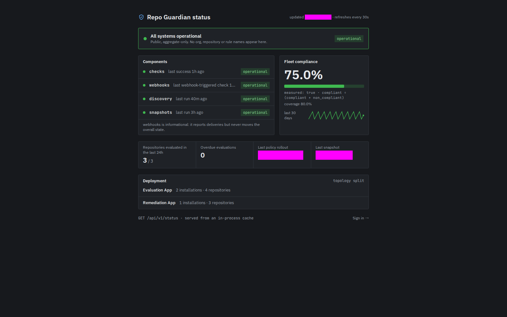

# The business UI

The UI (DESIGN-0027) shows compliance to people who are not operators:
where the fleet stands, which rules fail and where, and what
repo-guardian is doing about it. It is read-only and shows the API's
data scoped to your groups. Operators keep Grafana for the service
itself.

<!--toc:start-->
- [Enabling it](#enabling-it)
- [The shell](#the-shell)
- [Views](#views)
- [Sessions](#sessions)
- [Rotating session keys](#rotating-session-keys)
- [Security properties](#security-properties)
<!--toc:end-->

## Enabling it

The UI needs the API with authentication on (see [the API](api.md)):

```yaml
api:
  enabled: true
  auth:
    issuer: https://keycloak.example.com/realms/platform
  authz:
    groups:
      team-web: ["acme"]
ui:
  enabled: true
  existingSecret: repo-guardian-ui
  docsUrl: https://docs.example.com/repo-guardian   # optional: the sidebar Docs link
  ingress:
    enabled: true
    className: nginx
    host: guardian.example.com
    tls:
      - hosts: [guardian.example.com]
        secretName: guardian-tls
```

The Secret holds the OIDC client secret and the session keys:

```bash
kubectl -n repo-guardian create secret generic repo-guardian-ui \
  --from-literal=oidc-client-secret="$CLIENT_SECRET" \
  --from-literal=session-keys="$(openssl rand -base64 48)"
```

The UI signs users in against `api.auth.issuer` with the confidential
client `ui.oidc.clientId` (default `repo-guardian-ui`). The Keycloak
setup is in [the API docs](api.md#keycloak-example). The redirect URI
is `<public URL>/auth/callback`, where the public URL is `ui.publicUrl`
or `https://<ui.ingress.host>`.

The Ingress is the only one the chart renders, and it sends the whole
host to the UI. The webhook route stays yours; see
[webhook ingress](../operations/ingress.md#the-ui-host-chart-20).

## The shell

Every signed-in page shares one frame (DESIGN-0036):

- **Sidebar.** *Business* holds Fleet, Controls, Orgs, Repositories,
  History and Policy. *Public* holds the status page. A *Docs* group
  with one Documentation link appears only when `ui.docsUrl` is set.
  Below 900px the sidebar collapses behind a menu button in the top
  bar.
- **Time zone.** The *Local* / *UTC* toggle in the top bar sets how
  every timestamp prints. The choice is kept in the browser
  (`localStorage` key `rg.tz`), never sent to the server.
- **Account menu.** The avatar names you and holds **Sign out**.
- **Breadcrumbs** above every page title, ending at the control, org or
  repository you are on. A repository reads `org/name` (`…` for the
  moment it is loading), never its numeric id.

## Views

| View | Path | Shows |
| --- | --- | --- |
| Fleet | `/` | the compliance card (tracked, compliant % with its move over the range, non-compliant, parked, snapshots; series pills `?series=` choosing compliance %, findings, not applicable or unknown from `aggregate=fleet` history), finding age, the five worst controls with their deltas, parked by reason, assignments by bucket, compliance by control with a sparkline per row from one `aggregate=control` request, the orgs (or one org's exclusions under `?org=`), and — with the Remediation App — open PRs by age and PR throughput over 14 days |
| Findings | `/findings` | every non-compliant result: the repository, the control, its failing rules and reason, its remediation and how long it has failed. Filters map 1:1 to `GET /results` (`?control=`, `?rule=`, `?org=`, `?decision=`, `?pr_stale=`), sorted oldest first (`?sort=since_desc`, `?sort=pr_age` with the Remediation App); `?open=<repository id>/<control>` opens the finding's drawer — its rules, evidence, timeline, last evaluations and **Re-evaluate** |
| Controls | `/controls`, `/controls/<id>` | each assigned control's compliance and coverage; one control's posture by org and lineage, with the versions and revisions each org carries, its compliance over the range, its findings by failing rule and its ten oldest findings |
| Orgs | `/orgs`, `/orgs/<org>` | the orgs tree: each org a row (tracked, compliant, non-compliant, open PRs, parked) that expands (`?open=acme,globex`) to its repositories in the same grid, with a repository filter over the loaded rows (`?q=`), a **Parked** tab (reason and when) and a **PR activity** tab (open pull requests per org, stale and oldest; needs the Remediation App); cells shade by their share of the measured assignments and the footer sums the visible orgs. One org's baseline against what it added, its controls, its compliance over the range (`aggregate=org`), its five worst and its exclusions with their reasons |
| Repositories | `/repositories`, `/repositories/<id>` | repositories filtered by name and policy state (`?org=`, `?q=`, `?policy_state=`); one repository's controls, each with its bucket, mode and rule results with evidence, its evaluation log and its events, and **Re-evaluate** |
| History | `/history` | compliance over time from the daily snapshots, for every control or one (`?control=`), over 1, 7, 30 or 90 days (`?days=`) |
| Policy | `/policy` | the active policy version and rollout, each of your orgs' layers (added, replaced, excluded, excluded repositories, repository groups) and the catalogue entries they reference; the enterprise layer only for users who see every org |
| Status | `/status` | public service status: no login, no names |

Compliance and coverage show **no data** when there is nothing to
measure, never 100%. Evidence is text: its kind, then its fields as
`key: value` lines.

On a repository, **Remediable rule** says whether a rule can be fixed
by remediation at all; the facts card's **remediable** says whether the
Remediation App can reach this repository. A `no` there carries the
hint "Remediation App has no access to this repository".

**Re-evaluate** asks for the repository to be evaluated now. It is
hidden for a parked repository, and disappears for the session once the
API answers `501`, which an API without a Temporal client does (chart
value `api.temporal`).

The header's org scope (`?org=`) and the range (`?days=`) follow you
from page to page; a view's own filters stay behind. Every table has
an **Export** of the rows it shows as CSV; the findings export pages the
API up to 10,000 rows and says when that cap cut it short.

A signed-in user whose groups map to no org sees an "ask for access"
page with their name and subject, to quote to an administrator.

### The status page

`/status` is public: no sign-in, no cookie, and no org, repository or
control name. It shows a headline for the overall state, each component
(checks, webhooks, discovery, snapshots and each queue's backlog) with
its state, fleet compliance as one number with its coverage and 30-day
line, an operations strip (repositories evaluated in the last 24 hours
of those tracked, overdue evaluations, the newest policy's rollout and
the last snapshot), and the deployment: its topology and each App's
installation and repository counts. `webhooks` is informational and
never moves the overall state. It refreshes every 30 seconds.



## Sessions

- The session lives only in an encrypted, `HttpOnly`, `Secure`,
  `SameSite=Lax` cookie (`__Host-rg_session`), split into chunks when
  large. Page scripts cannot read it, and the browser never sees an
  access or refresh token.
- The UI's server refreshes the access token when it is within 60
  seconds of expiry. A failed refresh signs you out.
- A session lasts at most `ui.sessionTTL` (default `8h`), however long
  the IdP's refresh token lives. Then you sign in again.
- **Sign out** revokes the refresh token at the IdP (when it supports
  RFC 7009), clears the cookie and ends the IdP session.

There is no server-side session store. A copied cookie therefore works
until it expires. The 8h cap, revocation on sign-out and key rotation
bound that.

## Rotating session keys

`session-keys` is a comma-separated list. Each key must be at least 32
bytes. The **first** key seals new sessions, and **any** listed key
opens existing ones.

- **Routine rotation, no one signed out:** prepend a new key, keeping
  the old one:
  `session-keys: <new>,<old>`. Roll the UI. After `ui.sessionTTL` has
  passed, remove `<old>`.
- **Emergency (a key leaked):** replace the list with a fresh key alone
  and roll the UI. Every session is invalid at once and everyone signs
  in again.

```bash
kubectl -n repo-guardian create secret generic repo-guardian-ui \
  --from-literal=oidc-client-secret="$CLIENT_SECRET" \
  --from-literal=session-keys="$(openssl rand -base64 48),$OLD_KEY" \
  --dry-run=client -o yaml | kubectl apply -f -
kubectl -n repo-guardian rollout restart deploy/repo-guardian-ui
```

## Security properties

- Text from repositories (paths, file contents, setting values) is
  rendered as text only. There is no markdown rendering of evidence,
  and a lint rule bans every HTML sink in the UI's code.
- PR and repository links are built from the host (`ui.githubHost`),
  org, name and number, never copied from evidence, and open with
  `rel="noopener noreferrer"`.
- Every response carries `Content-Security-Policy: default-src 'self';
  connect-src 'self'; frame-ancestors 'none'; script-src 'self'`, plus
  `nosniff` and `Referrer-Policy: same-origin`.
- `/api/*` on the UI host forwards only `GET` and `HEAD`, plus the one
  `POST /repositories/<id>/evaluate` with a same-origin `Origin`, only
  to the `api` Service. It drops your cookies before forwarding and sends
  exactly one token: yours if you sent a Bearer, otherwise the
  session's.
- The UI pod holds no GitHub, Temporal or database credential.
