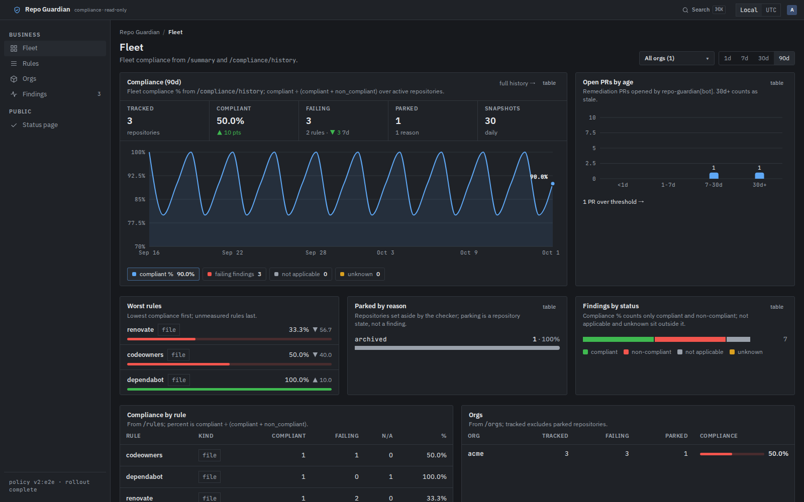
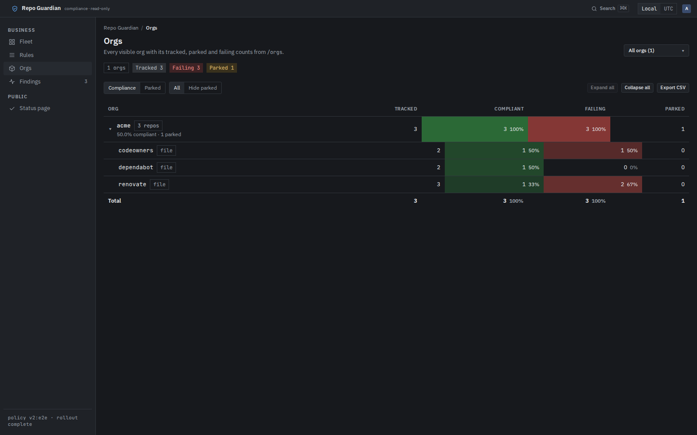
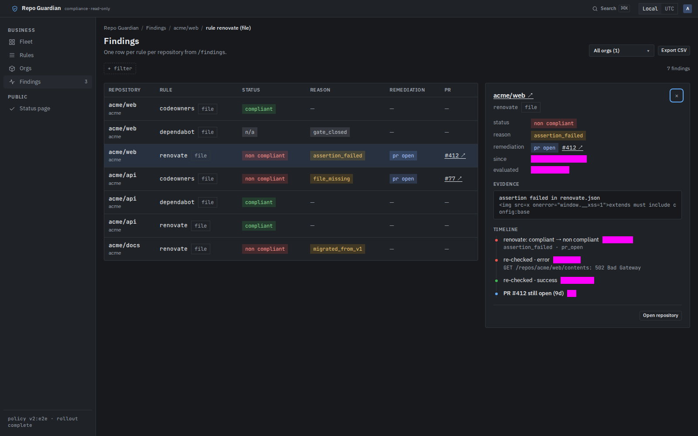
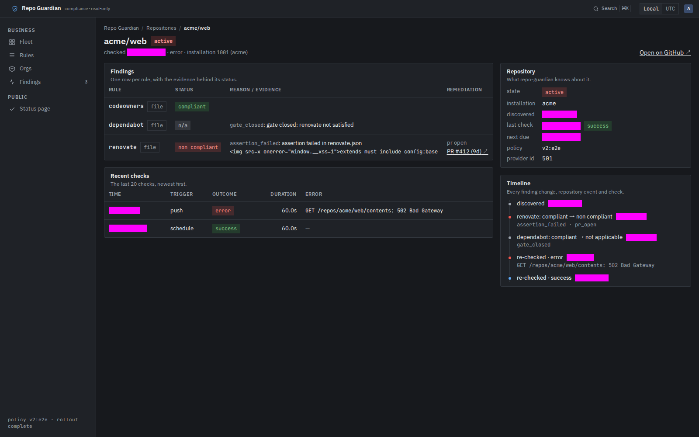

# The business UI

The UI (DESIGN-0027) shows compliance to people who are not operators:
where the fleet stands, which rules fail and where, and what
repo-guardian is doing about it. It is read-only and shows the API's
data scoped to your groups. Operators keep Grafana for the service
itself.

<!--toc:start-->
- [Enabling it](#enabling-it)
- [The shell](#the-shell)
- [Views](#views)
- [Sessions](#sessions)
- [Rotating session keys](#rotating-session-keys)
- [Security properties](#security-properties)
<!--toc:end-->

## Enabling it

The UI needs the API with authentication on (see [the API](api.md)):

```yaml
api:
  enabled: true
  auth:
    issuer: https://keycloak.example.com/realms/platform
  authz:
    groups:
      team-web: ["acme"]
ui:
  enabled: true
  existingSecret: repo-guardian-ui
  docsUrl: https://docs.example.com/repo-guardian   # optional: the sidebar Docs link
  ingress:
    enabled: true
    className: nginx
    host: guardian.example.com
    tls:
      - hosts: [guardian.example.com]
        secretName: guardian-tls
```

The Secret holds the OIDC client secret and the session keys:

```bash
kubectl -n repo-guardian create secret generic repo-guardian-ui \
  --from-literal=oidc-client-secret="$CLIENT_SECRET" \
  --from-literal=session-keys="$(openssl rand -base64 48)"
```

The UI signs users in against `api.auth.issuer` with the confidential
client `ui.oidc.clientId` (default `repo-guardian-ui`). The Keycloak
setup is in [the API docs](api.md#keycloak-example). The redirect URI
is `<public URL>/auth/callback`, where the public URL is `ui.publicUrl`
or `https://<ui.ingress.host>`.

The Ingress is the only one the chart renders, and it sends the whole
host to the UI. The webhook route stays yours; see
[webhook ingress](../operations/ingress.md#the-ui-host-chart-20).

## The shell

Every signed-in page shares one frame (DESIGN-0036):

- **Sidebar.** *Business* holds Fleet, Rules, Orgs and Findings; the
  Findings entry shows the failing-finding count from `/summary`.
  *Public* holds the status page. A *Docs* group with one
  Documentation link appears only when `ui.docsUrl` is set. Below
  900px the sidebar collapses behind a menu button in the top bar. Its
  footer names the enforced policy version and its rollout state.
- **Search (⌘K or Ctrl+K).** One box over repositories, rules and
  orgs. Enter opens the result and keeps the current org scope.
- **Time zone.** The *Local* / *UTC* toggle in the top bar sets how
  every timestamp prints. The choice is kept in the browser
  (`localStorage` key `rg.tz`), never sent to the server.
- **Account menu.** The avatar names you and holds **Sign out**.
- **Breadcrumbs** above every page title, ending at the open finding
  when the drawer is open.
- **Org scope.** The page-header button lists *All orgs (N)* and each
  org you can see. It writes `?org=`, which every page reads, so a
  scoped view is a shareable link. Pages with a trend add **range
  tabs** (1d, 7d, 30d, 90d, default 90d) that write `?range=`. Both
  survive navigation between pages.

## Views

| View | Path | Shows |
| --- | --- | --- |
| Fleet | `/` | the compliance trend with tracked, compliant, failing, parked and snapshot counts and their change over the range; series pills to switch the plotted measure; open PRs by age; the worst rules; parked repositories by reason; findings by status; compliance by rule and by org |
| Rules | `/rules`, `/rules/<kind>/<name>` | compliance per rule, filtered by kind tab; one rule by org with its top reasons and longest failures, and a button to its findings |
| Orgs | `/orgs`, `/orgs/<org>` | an expandable grid of orgs (expand one to list its rules), heat shading by compliance, parked or open-PR share, a hide-parked toggle, expand/collapse all and CSV export; one org's KPIs, trend, rule meters and why rules did not apply |
| Findings | `/findings` | every finding, filtered by chips, with CSV export of the loaded rows and a detail drawer |
| Repository | `/repos/<id>` | each rule's status with its evidence, the recent checks, the repository's facts and its timeline |
| History | `/history` | compliance over time, one chart per org, for all rules or one |
| Policy | `/policy` | the enforced policy version, its rollout and its rules |
| Status | `/status` | public service status: no login, no names |





### Findings and the drawer

Filters are chips above the table. **+ filter** adds one (status,
reason, remediation, kind, rule, org or stale PR); clicking a chip
changes or clears it. Every chip is a query parameter, so a filtered
table is a link.

Clicking a row opens the finding's drawer: status, reason, remediation
with its PR, evidence, and a timeline merging the finding's changes,
the repository's events, recent checks and the open PR. The drawer is
a deep link, `?open=<repository id>/<kind>/<rule>`, so it can be
shared or bookmarked. From 1600px wide the drawer sits beside the
table and the table drops its Age and Since columns; below that it
overlays the page. Escape closes it and returns focus to the row.





Compliance shows **unmeasured** when there is nothing to measure, never
100%. A finding carried over from v1 reads "last checked by v1; details
on next check" until its repository's next check.

A signed-in user whose groups map to no org sees an "ask for access"
page with their name and subject, to quote to an administrator.

### The status page

`/status` is public: no sign-in, no cookie, and no org, repository or
rule name. It shows a headline for the overall state, each component
(checks, webhooks, discovery, snapshots, GitHub budget) with its
state, fleet compliance as one number with its 30-day line, and an
operations strip: repositories checked in the last 24 hours of those
tracked, the newest policy's rollout and the last snapshot. `webhooks`
is informational and never moves the overall state. It refreshes
every 30 seconds.


## Sessions

- The session lives only in an encrypted, `HttpOnly`, `Secure`,
  `SameSite=Lax` cookie (`__Host-rg_session`), split into chunks when
  large. Page scripts cannot read it, and the browser never sees an
  access or refresh token.
- The UI's server refreshes the access token when it is within 60
  seconds of expiry. A failed refresh signs you out.
- A session lasts at most `ui.sessionTTL` (default `8h`), however long
  the IdP's refresh token lives. Then you sign in again.
- **Sign out** revokes the refresh token at the IdP (when it supports
  RFC 7009), clears the cookie and ends the IdP session.

There is no server-side session store. A copied cookie therefore works
until it expires. The 8h cap, revocation on sign-out and key rotation
bound that.

## Rotating session keys

`session-keys` is a comma-separated list. Each key must be at least 32
bytes. The **first** key seals new sessions, and **any** listed key
opens existing ones.

- **Routine rotation, no one signed out:** prepend a new key, keeping
  the old one:
  `session-keys: <new>,<old>`. Roll the UI. After `ui.sessionTTL` has
  passed, remove `<old>`.
- **Emergency (a key leaked):** replace the list with a fresh key alone
  and roll the UI. Every session is invalid at once and everyone signs
  in again.

```bash
kubectl -n repo-guardian create secret generic repo-guardian-ui \
  --from-literal=oidc-client-secret="$CLIENT_SECRET" \
  --from-literal=session-keys="$(openssl rand -base64 48),$OLD_KEY" \
  --dry-run=client -o yaml | kubectl apply -f -
kubectl -n repo-guardian rollout restart deploy/repo-guardian-ui
```

## Security properties

- Text from repositories (assertion messages, paths, PR titles) is
  rendered as text only. There is no markdown rendering of evidence,
  and a lint rule bans every HTML sink in the UI's code.
- PR and repository links are built from the host (`ui.githubHost`),
  org, name and number, never copied from evidence, and open with
  `rel="noopener noreferrer"`.
- Every response carries `Content-Security-Policy: default-src 'self';
  connect-src 'self'; frame-ancestors 'none'; script-src 'self'`, plus
  `nosniff` and `Referrer-Policy: same-origin`.
- `/api/*` on the UI host forwards only `GET` and `HEAD`, only to the
  `api` Service. It drops your cookies before forwarding and sends
  exactly one token: yours if you sent a Bearer, otherwise the
  session's.
- The UI pod holds no GitHub, Temporal or database credential.
